# Medir cuánto se mueve la costa desde el espacio, y qué tan bien se mide

*Material didáctico · desde cero hasta el manuscrito*

Parra-O., F. y Marín, M. (2026). strandline: a dependency-light Rust engine for satellite-derived shoreline extraction and change analysis, benchmarked against CoastSat along the coast of Chile. Borrador para Computers & Geosciences.

- [Cómo usar este material](#cómo-usar-este-material)
- [Nivel 0 · Lo que ya sabes de las playas](#nivel-0)
- [Nivel 1 · Lo que mide un satélite y cómo se mide la costa](#nivel-1)
- [Nivel 2 · Las piezas del método](#nivel-2)
- [Nivel 3 · Los métodos que el artículo da por sabidos](#nivel-3)
- [Nivel 4 · Lo que aporta el manuscrito y lo que deja abierto](#nivel-4)
- [Glosario](#glosario)
- [Respuestas](#respuestas)

# Cómo usar este material

Este material explica un artículo científico sobre un programa que mide, con imágenes de satélite, cuánto avanza o retrocede la costa. El programa se llama strandline. Es una copia más rápida de otro programa, CoastSat, que es el más usado para esta tarea. El material sube por cinco niveles. Cada nivel usa solo lo que enseñaron los anteriores.

Si ya conoces el tema, responde las preguntas de diagnóstico y empieza en el primer nivel donde falles. Al final de cada nivel hay preguntas. Respóndelas antes de mirar la respuesta: recordar es lo que fija lo aprendido.

El mapa muestra los conceptos de cada nivel y las afirmaciones del artículo a las que llevan. Una flecha va de lo que hay que saber antes a lo que se apoya en eso.

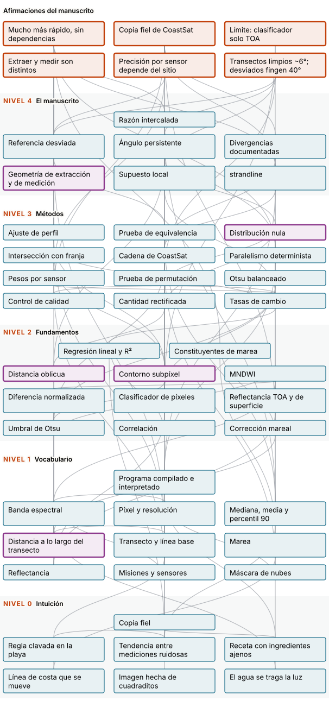

> [!IMPORTANT]
>
> **¿Desde dónde partes?**
>
> *Responde sin mirar las respuestas. Si aciertas todas las preguntas de un nivel, puedes saltarte ese nivel.*
>
> **Pregunta D1 · Nivel 0**
>
> Mides el ancho de una playa con una huincha una vez al año durante diez años. Las medidas suben y bajan. ¿Cómo decides si la playa se está achicando?
>
> *[Respuesta D1](#r-diag-1)*
>
> **Pregunta D2 · Nivel 1**
>
> ¿Qué es un transecto y qué se mide a lo largo de él?
>
> *[Respuesta D2](#r-diag-2)*
>
> **Pregunta D3 · Nivel 2**
>
> Un transecto forma un ángulo de 60° con la dirección perpendicular a la costa. La costa retrocede 10 m. ¿Cuánto mide el transecto?
>
> *[Respuesta D3](#r-diag-3)*
>
> **Pregunta D4 · Nivel 3**
>
> ¿Por qué un estimador del valor absoluto de un ángulo da en promedio más que cero aunque el ángulo verdadero sea cero?
>
> *[Respuesta D4](#r-diag-4)*

# Nivel 0 · Lo que ya sabes de las playas

> [!NOTE]
>
> **Al terminar este nivel podrás**
>
> - Explicar por qué la orilla de una playa cambia de lugar en horas, meses y años.
> - Describir cómo medirías el retroceso de una playa con una regla fija.
> - Distinguir una tendencia de las subidas y bajadas de cada medición.
> - Explicar por qué una copia de un procedimiento se compara con el original.

Este nivel no usa fórmulas ni palabras técnicas. Parte de cosas que has visto en una playa, en una foto o en una cocina.

> [!NOTE]
>
> **Concepto: Línea de costa que se mueve**
>
> La línea de costa es el borde entre el agua y la tierra. No se queda quieta: cambia de lugar en horas, en meses y en décadas.

En una misma tarde, el agua sube y baja por la marea. En una tarde de olas grandes, la espuma llega más arriba. En invierno, las marejadas se llevan arena y la playa queda más angosta. En verano, la arena vuelve.

Hay también cambios lentos. Una playa puede perder un par de metros por año durante treinta años. Ese retroceso lento es el que importa para planificar: decide si una casa o un camino quedarán algún día en el agua.

El problema es que el cambio lento queda escondido bajo los cambios rápidos. Un retroceso de 1 m por año es mucho más chico que lo que mueve la marea en una tarde.

> [!CAUTION]
>
> **Simplificación honesta**
>
> En este nivel decimos que la línea de costa es «el borde entre el agua y la tierra», como si fuera una raya nítida. No lo es: la arena mojada, la espuma y las olas hacen que el borde sea una franja. Más adelante verás que la línea se define con una regla precisa sobre la imagen.

> [!NOTE]
>
> **Concepto: Imagen hecha de cuadraditos**
>
> Una foto digital está hecha de cuadraditos. Cada cuadradito tiene un solo color, aunque en la realidad ese pedazo de suelo tenga varias cosas.

Si haces zoom en una foto del celular, terminas viendo cuadraditos de colores parejos. Una imagen de satélite funciona igual. La diferencia es el tamaño: en las imágenes de este material, cada cuadradito cubre un pedazo de terreno de 15 o 30 metros de lado.

Un cuadradito de 30 metros puede contener arena, agua y espuma al mismo tiempo. El satélite le asigna un solo valor, que es una mezcla de todo lo que hay adentro.

> [!NOTE]
>
> **Concepto: El agua se traga la luz**
>
> El agua profunda absorbe casi toda la luz que le llega y se ve oscura. La arena seca devuelve mucha luz y se ve clara.

Desde un avión, el mar se ve oscuro y la playa se ve clara. Ese contraste es la base de todo el método: si la tierra devuelve luz y el agua no, el borde entre lo claro y lo oscuro es la orilla.

El contraste no es igual para todos los colores de luz. Hay luces que el agua se traga casi por completo y otras que deja pasar un poco. El nivel 1 vuelve sobre esto.

> [!TIP]
>
> **Analogía**
>
> La orilla vista desde arriba es como el borde de una mancha de tinta en un papel. Donde hay tinta el papel es oscuro, y donde no hay es claro.
>
> **Dónde falla:** el borde de una mancha de tinta queda fijo. La orilla se mueve todo el tiempo, y además hay zonas grises, como la arena mojada y la espuma, que no son ni agua ni tierra seca.

> [!NOTE]
>
> **Concepto: Regla clavada en la playa**
>
> Para medir cuánto se mueve la orilla, conviene clavar una regla en la arena, apuntando al mar. En cada visita se anota dónde llega el agua sobre esa regla.

Imagina que clavas una estaca en la duna, detrás de la playa, y tiendes una huincha recta hacia el mar. Cada mes anotas en qué metro de la huincha está la orilla. Si la orilla pasa del metro 40 al metro 35 en cinco años, la playa perdió 5 m.

La huincha tiene que quedar siempre en el mismo lugar. Si la mueves entre una visita y otra, no sabes si cambió la playa o cambió la huincha.

La huincha también tiene que apuntar derecho al mar, cruzando la orilla de frente. Si la tiendes en diagonal, cada metro de retroceso aparece como más de un metro en la huincha. El nivel 2 calcula cuánto más.

> [!NOTE]
>
> **Ejemplo resuelto: leer la huincha**
>
> Una huincha va desde una estaca en la duna hacia el mar. En 2015 la orilla está en el metro 62. En 2025 está en el metro 50.
>
> 1.  La orilla se acercó a la estaca: el número bajó.
> 2.  La diferencia es 62 − 50 = 12 m.
> 3.  En diez años, eso es 12 / 10 = 1,2 m por año de retroceso.

> [!NOTE]
>
> **Concepto: Tendencia entre mediciones ruidosas**
>
> Una tendencia es el cambio que se mantiene a lo largo de muchas mediciones. Las subidas y bajadas de cada medición alrededor de esa tendencia se llaman ruido.

Si mides la orilla una vez al año, una medida puede caer en marea alta y otra en marea baja. Una puede venir justo después de una marejada. Por eso dos medidas sueltas engañan.

Con cuarenta años de medidas, el cuadro cambia. Las subidas y bajadas siguen ahí, pero alrededor de ellas se ve una dirección general. Es como el peso de una persona: sube y baja de un día a otro, pero en un año se nota si va subiendo.

> [!NOTE]
>
> **Ejemplo para completar: primero y último, o todos**
>
> 
>
> Tienes medidas de la orilla, en metros sobre la huincha: 2015: 62; 2017: 55; 2019: 60; 2021: 52; 2023: 54; 2025: 50. Si usas solo la primera y la última, el retroceso total es \_\_\_\_ m. Si miras todas, ves que la medida de 2017 está \_\_\_\_ que las de 2015 y 2019, así que probablemente es ruido.
>
> *[Respuesta E1](#r-ejer-1)*

> [!NOTE]
>
> **Concepto: Receta con ingredientes ajenos**
>
> Una receta que pide ingredientes de muchas tiendas distintas es frágil. Si una tienda cierra o cambia un producto, la receta deja de funcionar aunque no haya cambiado nada en ella.

Los programas de computador son parecidos a una receta. Muchos programas no hacen todo solos: piden prestadas piezas escritas por otras personas. A esas piezas se les llama dependencias.

Mientras más piezas ajenas pide un programa, más fácil es que algo falle al instalarlo en otro computador. Una pieza puede haber cambiado de versión, o puede estar disponible solo en una tienda.

> [!TIP]
>
> **Analogía**
>
> Un programa con muchas dependencias es como un mueble armable que trae tornillos de otro fabricante. Si ese fabricante deja de vender los tornillos, el mueble no se puede armar.
>
> **Dónde falla:** a un tornillo lo puedes reemplazar por otro parecido. Una pieza de software a veces no tiene reemplazo, o el reemplazo da resultados algo distintos.

> [!NOTE]
>
> **Concepto: Copia fiel**
>
> Una copia fiel de un procedimiento es una que, con los mismos ingredientes, da el mismo resultado que el original. Para saber si es fiel, se preparan las dos versiones y se comparan los resultados.

Si copias a mano la receta de pan de tu abuela, no basta con que la copia se vea parecida. Tienes que hornear las dos versiones y comparar los panes. Si salen distintos, la copia tiene un error, aunque no lo veas al leerla.

El artículo hace exactamente esto: comprueba que strandline, su programa, da los mismos resultados que CoastSat, el programa original.

Comparar contra el original sirve para una cosa precisa: muestra que la copia hace lo mismo. No muestra que la receta original sea buena. Si el pan de la abuela era malo, una copia fiel también da pan malo.

> [!WARNING]
>
> **Error común**
>
> **Se cree que** si una copia da el mismo resultado que el original, entonces da el resultado correcto. **En realidad** solo da el mismo resultado. Si el original tiene un error, la copia fiel lo repite. Comparar con el original prueba fidelidad, no exactitud.

**Pregunta 1 · recuperación**

¿Por qué la huincha que mide la orilla tiene que quedar siempre en el mismo lugar?

*[Respuesta 1](#r-preg-1)*

**Pregunta 2 · recuperación**

¿Qué prueba comparar una copia de una receta con la receta original?

*[Respuesta 2](#r-preg-2)*

**Pregunta 3 · explícalo con tus palabras**

Explica con tus palabras por qué un retroceso de 1 m por año es difícil de ver si solo comparas dos fotos de la playa tomadas en días distintos.

*[Respuesta 3](#r-preg-3)*

> [!TIP]
>
> **En pocas palabras**
>
> La orilla se mueve por la marea, las olas y las estaciones, y debajo de eso hay un cambio lento que es el que importa. Para medirlo hace falta una regla fija que apunte derecho al mar y muchas mediciones. Un programa que copia un método se comprueba contra el original, y eso prueba fidelidad, no exactitud.

# Nivel 1 · Lo que mide un satélite y cómo se mide la costa

> [!NOTE]
>
> **Al terminar este nivel podrás**
>
> - Definir píxel, banda espectral y reflectancia con un ejemplo.
> - Nombrar las misiones de satélite que usa el artículo y decir en qué se diferencian.
> - Explicar qué es un transecto y qué número se mide a lo largo de él.
> - Calcular la mediana y el percentil 90 de una lista corta de números.
> - Explicar la diferencia entre un programa compilado y uno interpretado.

Este nivel pone nombre a las ideas del nivel 0. Cada palabra nueva viene con un ejemplo.

## La imagen de satélite

> [!NOTE]
>
> **Concepto: Píxel y resolución**
>
> Un píxel es cada cuadradito de una imagen digital: el satélite le asigna un solo valor. La resolución es el tamaño en el terreno del lado de un píxel; una resolución de 30 m significa cuadraditos de 30 por 30 metros.

Este es el nombre técnico de la [imagen hecha de cuadraditos](#c-foto-cuadraditos) del nivel 0. A cada imagen de satélite también se le llama escena. Las imágenes del artículo tienen píxeles de 30 m o de 15 m. Una playa de 60 m de ancho ocupa apenas dos píxeles de 30 m.

Por eso importa ubicar la orilla con más detalle que un píxel entero. Si la línea solo pudiera pasar por los bordes de los píxeles, el error típico sería de varios metros. El nivel 2 muestra cómo se ubica la línea dentro de un píxel.

> [!CAUTION]
>
> **Simplificación honesta**
>
> Por ahora piensa que cada píxel es «de agua» o «de tierra». En la orilla eso no es cierto: un píxel puede ser mitad agua y mitad arena. Esa mezcla es justamente lo que permite ubicar la línea dentro del píxel. El nivel 2 muestra cómo.

> [!NOTE]
>
> **Concepto: Banda espectral**
>
> Una banda espectral es un rango de colores de luz que el sensor del satélite mide por separado. El sensor entrega una imagen por banda, píxel por píxel.

Los colores de la luz tienen un orden, el del arcoíris: azul, verde, amarillo, rojo. Ese orden sigue más allá del rojo, con luces que tus ojos no ven. Los físicos ordenan los colores por su longitud de onda; para este material basta con el orden.

Una cámara de celular mide tres bandas: rojo, verde y azul. Un satélite de observación mide más, incluidas algunas de esas luces invisibles. Tres bandas importan aquí:

- **Verde**: la luz verde que ves. El agua devuelve algo de verde.
- **Infrarrojo cercano**, abreviado NIR: una luz invisible, justo después del rojo. El agua se lo traga casi entero; la arena seca devuelve bastante.
- **Infrarrojo de onda corta**, abreviado SWIR1: otra luz invisible, todavía más allá del NIR en el mismo orden. El agua también se la traga casi entera.

Las imágenes del artículo traen cinco bandas: azul, verde, rojo, NIR y SWIR1.

Así se precisa la idea de que [el agua se traga la luz](#c-agua-oscura): el agua se traga sobre todo el infrarrojo. En el verde, el agua todavía devuelve algo de luz. En el SWIR1 no devuelve casi nada. La arena hace lo contrario: devuelve más SWIR1 que verde. Ese contraste entre verde y SWIR1 es el que usa el método.

> [!NOTE]
>
> **Concepto: Reflectancia**
>
> La reflectancia es la fracción de la luz que llega a un píxel y que ese píxel devuelve, en una banda. Va de 0 (devuelve nada) a 1 (devuelve todo).

La arena seca puede tener una reflectancia de 0,3 en el SWIR1: devuelve el 30 % de esa luz. El agua puede tener 0,01: devuelve el 1 %.

Usar la fracción, y no la cantidad de luz, permite comparar días distintos. En invierno, con el Sol más bajo, llega menos luz a todo el suelo, y la arena devuelve menos luz que en verano. Pero devuelve la misma fracción de la luz que le llega. La reflectancia no cambia aunque cambie la iluminación.

> [!NOTE]
>
> **Ejemplo resuelto: reflectancia de dos píxeles**
>
> Un píxel de arena recibe 500 unidades de luz SWIR1 y devuelve 150. Un píxel de mar recibe las mismas 500 y devuelve 5.
>
> 1.  Reflectancia de la arena: 150 / 500 = 0,30.
> 2.  Reflectancia del mar: 5 / 500 = 0,01.
> 3.  La arena devuelve 30 veces más SWIR1 que el mar. Ese contraste marca la orilla.

> [!NOTE]
>
> **Concepto: Misiones y sensores**
>
> Una misión es una serie de satélites, y cada satélite lleva un sensor, que es el instrumento que mide las bandas. El artículo usa Landsat 5, 7, 8 y 9 y, en algunos sitios, Sentinel-2.

Los satélites Landsat toman imágenes de todo el planeta desde 1984. Cada uno vuelve a pasar por el mismo lugar cada 16 días, siempre a la misma hora del reloj, a media mañana. El artículo usa cuatro satélites. TM, ETM+, OLI y OLI-2 son solo los nombres de sus sensores:

| Satélite  | Sensor | Años de uso en el artículo |
|-----------|--------|----------------------------|
| Landsat 5 | TM     | 1984 a 2011                |
| Landsat 7 | ETM+   | 1999 en adelante           |
| Landsat 8 | OLI    | 2013 en adelante           |
| Landsat 9 | OLI-2  | 2021 en adelante           |

Sentinel-2 es una misión europea que empezó en 2015, con píxeles de 10 a 20 m y pasadas más frecuentes.

Los sensores no son idénticos. Miden bandas parecidas pero no iguales, y unos tienen menos ruido que otros. Por eso una misma playa puede salir un poco distinta según el satélite que la fotografió. El nivel 3 vuelve sobre esto.

> [!NOTE]
>
> **Concepto: Máscara de nubes**
>
> Una máscara de nubes es una segunda imagen, del mismo tamaño, que marca qué píxeles están cubiertos por nubes. Esos píxeles no se usan para buscar la orilla.

Una nube tapa el suelo y es muy clara, como la arena. Si no se marca, el programa puede confundir el borde de una nube con una orilla. La máscara viene con cada imagen Landsat. Tiene errores: a veces marca como nube la espuma blanca de las olas.

Algunos píxeles no tienen ningún valor: son píxeles sin datos. Aparecen en el borde de la escena, donde el satélite no alcanzó a mirar, o en franjas que un sensor dañado no registró. El programa los trata como las nubes: no busca la orilla en ellos.

## La medición de la costa

> [!NOTE]
>
> **Concepto: Transecto y línea base**
>
> Un transecto es una línea recta fija que va desde tierra hacia el mar, cruzando la orilla. La línea base es una línea dibujada en tierra, paralela a la costa, desde la que salen los transectos, uno cada cierta distancia.

El transecto es la versión de computador de la [regla clavada en la playa](#c-regla-playa). En vez de una huincha, hay cientos de líneas imaginarias, por ejemplo una cada 100 m a lo largo de la costa. Se dibujan una sola vez y no se mueven.

<figure>
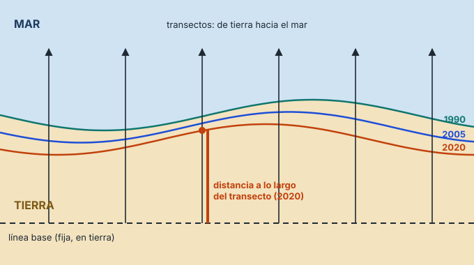
<figcaption aria-hidden="true">Transectos vistos desde arriba. Salen de la línea base y cruzan las líneas de costa de tres fechas. A lo largo de cada transecto se mide una distancia por fecha.</figcaption>
</figure>

El artículo genera los transectos de forma automática, perpendiculares a la línea base.

La línea base sale de una línea de costa elegida como referencia, llamada línea de referencia. El nivel 4 muestra que de dónde sale esa línea importa mucho. Esa línea se suaviza un poco: se le quitan las curvas más pequeñas. Los transectos quedan perpendiculares a la línea de referencia.

> [!CAUTION]
>
> **Simplificación honesta**
>
> En este nivel decimos que cada transecto cruza la orilla de frente, en ángulo recto. Eso es cierto para la línea de referencia de la que salieron los transectos. Para la orilla de otra fecha, que puede tener otra forma, no tiene por qué serlo.

> [!IMPORTANT]
>
> **Concepto umbral: Distancia a lo largo del transecto**
>
> La distancia a lo largo del transecto es cuántos metros hay desde el origen del transecto, en tierra, hasta el punto donde lo cruza la línea de costa de una fecha. Con ella, una línea completa se reduce a un solo número por transecto y por fecha.

En inglés se le dice *chainage* o *cross-shore distance*. Este número es el que convierte un problema de mapas en un problema de números. Una línea de costa es una curva complicada. Pero sobre cada transecto se reduce a un número, y una serie de fechas se vuelve una lista de números.

En la figura anterior, el tramo naranjo grueso es la distancia de 2020 en un transecto. Si la distancia baja de un año a otro, la orilla se acercó al origen en tierra: la playa retrocedió. Si sube, la playa avanzó hacia el mar.

> [!TIP]
>
> **Analogía**
>
> La distancia a lo largo del transecto es como marcar en el marco de una puerta la estatura de un niño cada cumpleaños. No te interesa toda la silueta del niño, solo una altura por año. Con eso ves cuánto creció.
>
> **Dónde falla:** el niño se para siempre derecho contra el marco. La orilla, en cambio, puede cruzar el transecto en diagonal, y entonces la distancia marcada no es el avance real. Eso se calcula en el nivel 2.

> [!WARNING]
>
> **Error común**
>
> **Se cree que** la distancia a lo largo del transecto mide dónde está la playa en el mapa. **En realidad** mide dónde la cruza la orilla sobre una línea fija. Si el transecto está mal orientado, el número cambia aunque la playa sea la misma.

> [!NOTE]
>
> **Concepto: Marea**
>
> La marea es la subida y bajada del nivel del mar, por lo general dos veces al día. El rango mareal es la diferencia entre la marea alta y la baja.

Al subir la marea, el agua avanza sobre la playa. Mientras más plana es la playa, más avanza el agua por cada centímetro que sube. En una playa plana, un metro de marea puede mover la orilla 20 m o más.

Una costa con poca diferencia entre marea alta y baja se llama micromareal, como la de Chile central. Una con mucha diferencia se llama macromareal, como el archipiélago de Chiloé.

El satélite pasa siempre a la misma hora del reloj. La marea, en cambio, se atrasa unos 50 minutos cada día. Por eso cada imagen capta la orilla con una marea distinta: un día con marea alta, otro con marea baja.

## Herramientas para leer números

> [!NOTE]
>
> **Concepto: Mediana, media y percentil 90**
>
> La mediana de una lista de números es el valor del medio cuando se ordenan: la mitad queda abajo y la mitad arriba. La media es la suma dividida por la cantidad, y el percentil 90 es el valor que deja al 90 % de los números en él o por debajo.

Las tres sirven para resumir una lista de errores, por ejemplo cuánto se separan dos líneas de costa en muchos puntos. Cada una cuenta algo distinto.

Si la lista tiene una cantidad par de números, hay dos valores del medio, y la mediana es el promedio de los dos.

La mediana dice cómo es el caso típico. Un número extremo no la mueve: por eso se dice que es una medida robusta. La media sí se mueve con los extremos: un solo error de 500 m sube mucho la media. El percentil 90 dice qué tan malos son los peores casos, sin llegar al peor de todos.

La desviación típica mide cuánto se alejan en general los números de su media: es parecida a un «error típico». Se calcula elevando al cuadrado la distancia de cada número a la media, promediando esos cuadrados y sacando la raíz. El promedio de los cuadrados, antes de sacar la raíz, se llama varianza. Por eso la varianza queda en unidades al cuadrado: si la desviación típica es 2 m, la varianza es 4 m².

Hay una cuarta medida que se usa en el nivel 4. El rango intercuartílico, que en inglés se abrevia IQR, mide cuánto se dispersan los números del medio. Se calcula como el valor que deja al 75 % de los números en él o por debajo, menos el que deja al 25 %. Un IQR chico indica valores parejos.

> [!NOTE]
>
> **Ejemplo resuelto: tres resúmenes de los mismos errores**
>
> Diez errores, en metros: 1, 1, 2, 2, 2, 3, 3, 4, 6, 76.
>
> 1.  Mediana: ordenados, los del medio son el quinto y el sexto (2 y 3). La mediana es 2,5 m.
> 2.  Media: la suma es 100, y 100 / 10 = 10 m.
> 3.  Percentil 90: el 90 % de los diez valores son nueve, y el noveno es 6. El percentil 90 es 6 m.
> 4.  El error de 76 m sube la media a 10 m, pero casi no cambia la mediana.
> 5.  IQR: el primer valor que deja al 25 % o más en él o por debajo es el tercero (2), porque deja 3 de 10. El que deja al 75 % es el octavo (4). El IQR es 4 − 2 = 2 m: la mitad central de los errores cabe en 2 m.

> [!NOTE]
>
> **Ejemplo para completar**
>
> 
>
> Siete errores, en metros: 0,1; 0,2; 0,2; 0,3; 0,4; 0,5; 9. La mediana es \_\_\_\_ m. La media es \_\_\_\_ m. ¿Cuál describe mejor el caso típico? \_\_\_\_.
>
> *[Respuesta E2](#r-ejer-2)*

Cuatro palabras más sirven para hablar de mediciones. Ninguna es un concepto nuevo del método: son vocabulario.

- La **distribución** de una lista de números es su forma: cuántos valores hay de cada tamaño. El histograma del nivel 2 la dibuja.
- La **cola** de una distribución son sus valores extremos, poco frecuentes. El error de 76 m del ejemplo está en la cola.
- Un **estimador** es un procedimiento que calcula un valor a partir de datos con ruido. Su resultado también se llama **estadístico**. La mediana es un estimador del caso típico.
- El **sesgo** es un error que empuja siempre hacia el mismo lado. Se distingue del ruido, que sube y baja al azar. Una huincha estirada tiene sesgo: siempre mide de menos.

## Cómo se construye un programa

> [!NOTE]
>
> **Concepto: Programa compilado e interpretado**
>
> Un programa interpretado se traduce a instrucciones de máquina línea por línea mientras corre. Un programa compilado se traduce entero una vez, antes de correr, y queda como un solo archivo ejecutable, llamado binario.

El procesador de un computador solo entiende órdenes muy simples, llamadas instrucciones de máquina. Todo programa escrito por una persona se tiene que traducir a esas órdenes.

Python es un lenguaje interpretado: necesita que el computador tenga instalado Python y las [dependencias](#c-receta-ingredientes) que el programa pide. Rust es un lenguaje compilado: el resultado es un binario que corre solo. El artículo llama «motor» a su programa en Rust.

El motor se usa desde la línea de comandos: una ventana donde se escriben órdenes en texto. Cada orden del motor, como «extraer la línea» o «calcular tasas», se llama subcomando. La salida de un subcomando sirve de entrada al siguiente: eso es encadenarlos. Los cálculos viven en una biblioteca, que es una colección de piezas de programa que otros programas pueden usar.

Un programa compilado suele ser mucho más rápido en tareas repetitivas, como recorrer millones de píxeles. También se instala más fácil, porque no pide nada aparte. A cambio, es más lento de escribir y de modificar. Python sigue siendo mejor para probar ideas.

> [!TIP]
>
> **Analogía**
>
> Un programa interpretado es como un intérprete que traduce un discurso frase por frase mientras el orador habla. Un programa compilado es como un libro ya traducido: lo lees directo, sin esperar al traductor.
>
> **Dónde falla:** un libro traducido no cambia, pero un programa compilado se puede volver a compilar en segundos cada vez que cambia el código. La diferencia real está en cuándo se traduce y en qué hay que tener instalado para usarlo.

**Pregunta 4 · recuperación**

¿Qué número se obtiene de cruzar un transecto con la línea de costa de una fecha?

*[Respuesta 4](#r-preg-4)*

**Pregunta 5 · recuperación**

¿Qué banda se traga el agua casi por completo, mientras la arena devuelve bastante?

*[Respuesta 5](#r-preg-5)*

**Pregunta 6 · aplicación**

Los errores de una comparación son: 0,1; 0,2; 0,2; 0,3; 0,4; 50 m. Alguien informa una media de 8,5 m y dice que el método es malo. ¿Qué número propones mirar y qué te dice?

*[Respuesta 6](#r-preg-6)*

**Pregunta 7 · explícalo con tus palabras**

Explica por qué cada imagen de satélite capta la orilla en un lugar algo distinto aunque la playa no haya cambiado.

*[Respuesta 7](#r-preg-7)*

> [!TIP]
>
> **En pocas palabras**
>
> Un satélite mide varias bandas por píxel, y el contraste entre verde e infrarrojo separa agua de tierra. Sobre transectos fijos, cada línea de costa se reduce a una distancia por fecha. La mediana, la media y el percentil 90 resumen listas de errores y cuentan cosas distintas.

# Nivel 2 · Las piezas del método

> [!NOTE]
>
> **Al terminar este nivel podrás**
>
> - Calcular el MNDWI de un píxel a partir de dos reflectancias.
> - Explicar cómo el umbral de Otsu separa agua de tierra en un histograma.
> - Calcular dónde cruza el contorno subpíxel entre dos centros de píxel.
> - Calcular la corrección mareal de una distancia con la fórmula del artículo.
> - Calcular cuánto alarga una medición un transecto que forma un ángulo θ con la normal.
> - Interpretar la pendiente, el R² y la correlación de una recta ajustada.

Este nivel presenta las piezas que el artículo da por sabidas. Cada fórmula viene con sus símbolos explicados en palabras y con un cálculo de ejemplo.

## Del píxel a la línea de costa

> [!NOTE]
>
> **Concepto: Diferencia normalizada**
>
> Una diferencia normalizada combina dos bandas de un píxel así: la resta de las dos dividida por su suma. El resultado siempre queda entre −1 y +1 si ambas reflectancias son positivas.

En símbolos, con dos [reflectancias](#c-reflectancia) $a$ y $b$:

$$\frac{a - b}{a + b}$$

La resta mide cuál banda domina. La división por la suma vuelve el número relativo. Si por cualquier razón las dos bandas salen multiplicadas por el mismo número, por ejemplo una imagen un poco más brillante en todo, el cociente no cambia.

El cociente vale +1 si $b$ es cero, −1 si $a$ es cero y 0 si son iguales.

> [!WARNING]
>
> **Error común**
>
> **Se cree que** una diferencia normalizada nunca puede salir de −1 y +1. **En realidad** eso solo vale si las dos reflectancias son positivas. Más abajo verás que algunas imágenes se corrigen por el efecto del aire: se les resta un brillo que el aire agrega, estimado con un modelo. Si se resta un poco de más, en sombras o agua oscura la reflectancia queda apenas bajo cero.
>
> Si la suma $a + b$ queda cerca de cero, el cociente puede valer cientos o miles. Por esa razón el motor del artículo descarta los resultados mayores que 5 en valor absoluto, es decir, sin contar su signo (Sec. 2.2, p. 8).

> [!IMPORTANT]
>
> **Concepto umbral: MNDWI**
>
> El MNDWI (por su nombre en inglés, índice de agua de diferencia normalizada modificado) es la diferencia normalizada entre la banda verde y la banda SWIR1. Es alto sobre el agua y bajo sobre la tierra.

Su fórmula, con $\rho$ (la letra griega rho) para la reflectancia de cada banda, es:

$$\mathrm{MNDWI} = \frac{\rho_\mathrm{verde} - \rho_\mathrm{SWIR1}}{\rho_\mathrm{verde} + \rho_\mathrm{SWIR1}}$$

Sobre el agua, el SWIR1 es casi cero, así que el índice se acerca a +1. Sobre la arena, el SWIR1 es mayor que el verde, así que el índice es negativo. Es la versión con números del contraste del nivel 1: el agua devuelve algo de verde y casi nada de SWIR1.

> [!NOTE]
>
> **Ejemplo resuelto: MNDWI de agua y de arena**
>
> Un píxel de mar tiene verde = 0,08 y SWIR1 = 0,01. Un píxel de arena tiene verde = 0,15 y SWIR1 = 0,30.
>
> 1.  Mar: (0,08 − 0,01) / (0,08 + 0,01) = 0,07 / 0,09 ≈ +0,78.
> 2.  Arena: (0,15 − 0,30) / (0,15 + 0,30) = −0,15 / 0,45 ≈ −0,33.
> 3.  El índice separa los dos píxeles por más de un punto entero.

> [!NOTE]
>
> **Ejemplo para completar**
>
> 
>
> Un píxel de la orilla, mitad arena y mitad agua, tiene verde = 0,12 y SWIR1 = 0,10. Resta = \_\_\_\_. Suma = \_\_\_\_. MNDWI ≈ \_\_\_\_. ¿Queda más cerca del mar o de la arena del ejemplo anterior? \_\_\_\_.
>
> *[Respuesta E3](#r-ejer-3)*

> [!NOTE]
>
> **Concepto: Umbral de Otsu**
>
> El umbral de Otsu es un método automático para elegir el valor que separa dos grupos en una lista de números. Elige el corte que deja cada grupo lo más parejo posible por dentro y los dos grupos lo más separados entre sí.

Un histograma cuenta cuántos píxeles tienen cada valor del índice. En una escena de costa, el histograma del [MNDWI](#c-mndwi) suele tener dos montes: uno de tierra, con valores bajos, y otro de agua, con valores altos.

<figure>
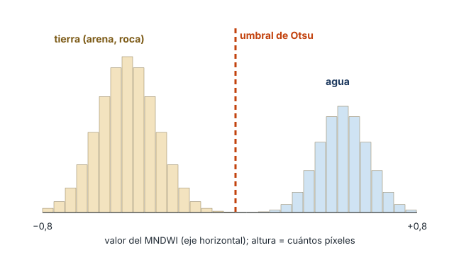
<figcaption aria-hidden="true">Histograma del MNDWI en una escena de costa. Los píxeles de tierra forman un monte a la izquierda y los de agua otro a la derecha. Otsu pone el umbral en el valle entre ellos.</figcaption>
</figure>

El método prueba todos los cortes posibles. Para cada uno, mide cuánto varían los valores dentro de cada grupo, y suma las dos variaciones. En esa suma, cada grupo pesa según cuántos píxeles tiene. Se queda con el corte en que la suma es menor. El resultado es un número, por ejemplo 0,1: los píxeles sobre 0,1 se consideran agua.

Lo valioso es que el umbral se calcula de nuevo en cada imagen. Si una imagen tiene agua más turbia o arena más oscura, el umbral se ajusta solo.

> [!IMPORTANT]
>
> **Concepto umbral: Contorno subpíxel**
>
> Un contorno subpíxel es una línea que pasa por los puntos donde el índice vale exactamente el umbral, estimados entre los centros de los píxeles. Así la línea puede pasar por dentro de un píxel y no solo por sus bordes.

Este concepto cambia la forma de ver una imagen. No la mires como un mosaico de cuadraditos de agua o de tierra. Mírala como valores medidos en puntos, los centros de los píxeles, con una superficie suave entre ellos. La orilla es la curva donde esa superficie cruza el umbral.

<figure>
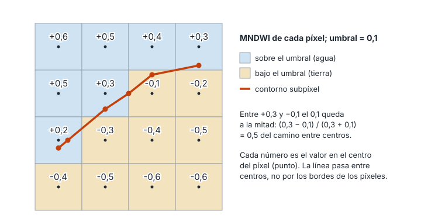
<figcaption aria-hidden="true">Contorno subpíxel sobre una grilla de 4 × 4 píxeles. Cada número es el MNDWI en el centro del píxel. La línea naranja une los puntos donde el índice cruza 0,1, interpolados entre centros vecinos.</figcaption>
</figure>

El cálculo es una regla de tres, que en matemáticas se llama interpolación lineal. Entre dos centros vecinos con valores $v_1$ y $v_2$, el umbral $u$ cae a una fracción $t$ del camino:

$$t = \frac{u - v_1}{v_2 - v_1}$$

Si los centros están a 30 m, el cruce queda $30\,t$ metros después del primero. El algoritmo que recorre la grilla y une esos puntos se llama *marching squares* («cuadrados que marchan»): solo es el nombre del procedimiento que hace esta interpolación en cada cuadrado de cuatro centros.

> [!NOTE]
>
> **Ejemplo resuelto: dónde cruza la orilla entre dos píxeles**
>
> Dos píxeles vecinos, con centros a 30 m. El de la izquierda tiene MNDWI = +0,3 y el de la derecha −0,1. El umbral es 0,1.
>
> 1.  Fracción: $t = (0{,}1 - 0{,}3) / (-0{,}1 - 0{,}3) = -0{,}2 / -0{,}4 = 0{,}5$.
> 2.  El cruce queda a 0,5 × 30 = 15 m del centro izquierdo.
> 3.  La orilla pasa por el medio, aunque ninguno de los dos píxeles sea «la orilla».

> [!NOTE]
>
> **Ejemplo para completar**
>
> 
>
> Otros dos píxeles a 30 m: +0,5 y −0,3. El umbral sigue en 0,1. $t$ = \_\_\_\_. El cruce queda a \_\_\_\_ m del primer centro.
>
> *[Respuesta E4](#r-ejer-4)*

> [!TIP]
>
> **Analogía**
>
> El contorno subpíxel es como las curvas de nivel de un mapa de cerros. Solo se midió la altura en algunos puntos. Aun así, la curva de los 100 m se dibuja entre ellos, suponiendo que el terreno sube parejo de un punto al siguiente.
>
> **Dónde falla:** el terreno sí es continuo entre dos puntos. Un píxel de 30 m en la orilla no es una pendiente suave: es una mezcla de arena, espuma y agua. La interpolación lineal es una aproximación razonable, no una medición de lo que pasa dentro del píxel. Además, dentro de cada cuadrado de cuatro centros la línea es un tramo recto. Por eso el contorno conserva pequeños quiebres, o escalones, al pasar de un cuadrado al siguiente.

> [!IMPORTANT]
>
> **Se corrige la simplificación**
>
> En el nivel 0 dijimos que la línea de costa es el borde entre agua y tierra, como una raya nítida. Ahora puedes precisarlo: en este método, la línea de costa es el contorno donde el MNDWI cruza un umbral. Es una definición operativa. Si cambia el umbral, la línea se mueve, aunque la playa sea la misma.

> [!IMPORTANT]
>
> **Se corrige la simplificación**
>
> En el nivel 1 dijimos que cada píxel es de agua o de tierra. En la orilla eso no es así: un píxel mezclado tiene un MNDWI intermedio. Gracias a esos valores intermedios el contorno subpíxel puede ubicar la orilla dentro de un píxel.

> [!WARNING]
>
> **Error común**
>
> **Se cree que** con píxeles de 30 m la orilla solo se puede ubicar con un error de unos 30 m. **En realidad** la interpolación entre centros la ubica a una fracción de píxel. Lo que limita la exactitud es cuánto se parece la interpolación a la mezcla real y qué tan bien elegido está el umbral. El tamaño del píxel por sí solo no la limita.

> [!NOTE]
>
> **Concepto: Clasificador de píxeles**
>
> Un clasificador de píxeles es un programa que asigna a cada píxel una clase, por ejemplo arena, agua, espuma u otro, a partir de sus bandas. Aprende la regla con ejemplos ya etiquetados por personas.

El clasificador del artículo es un tipo de programa que aprende de ejemplos. Su nombre es perceptrón multicapa, o MLP, y es una red neuronal pequeña; para este material son solo nombres. Devuelve una de cuatro clases: arena, agua, espuma de rompiente u otro.

Para decidir, recibe 20 números por píxel. Son las cinco bandas, cinco diferencias normalizadas y, para cada una de esas diez, cuánto varía en los píxeles vecinos.

La red se entrenó con ejemplos que alguien etiquetó a mano. Los números que aprendió se llaman pesos de la red, y se pueden copiar a otro programa. El original se escribió con scikit-learn, una biblioteca de Python; es solo un nombre.

La red solo funciona bien con imágenes parecidas a las de su entrenamiento.

El clasificador sirve para afinar el [umbral de Otsu](#c-otsu): en vez de usar toda la imagen, se usan solo los píxeles de arena y de agua. Así los cerros y las calles no desordenan el histograma.

> [!NOTE]
>
> **Concepto: Reflectancia TOA y de superficie**
>
> La reflectancia en el techo de la atmósfera (TOA) es la que mide el satélite, con el efecto del aire incluido. La reflectancia de superficie (SR) es la que queda después de restar con un modelo el efecto de la atmósfera.

Entre el suelo y el satélite hay aire, vapor y polvo. El aire agrega un brillo azulado y quita algo de luz. Por eso la misma playa da números distintos según el producto que uses: TOA o SR. El artículo usa los dos.

A cada versión de una imagen, TOA o SR, se le llama producto. Los productos SR que se bajan desde catálogos públicos tienen píxeles de 30 m.

Las imágenes TOA que el artículo usa como referencia tienen píxeles de 15 m. Algunas herramientas afinan las imágenes con una banda adicional más fina, en un proceso llamado *pansharpening* (solo el nombre). En la comparación principal del artículo ese proceso está desactivado: strandline y CoastSat leen la misma imagen de 15 m.

Por eso comparar una línea SR de 30 m con una TOA de 15 m es comparar dos productos distintos, no solo dos programas.

> [!WARNING]
>
> **Error común**
>
> **Se cree que** un clasificador entrenado con un tipo de imagen sirve para cualquier imagen del mismo lugar. **En realidad** si los números de entrada cambian de escala, la red recibe valores que nunca vio. El clasificador de CoastSat se entrenó con TOA. Con SR clasifica mal muchos píxeles (Sec. 7, p. 36).

## La marea

> [!NOTE]
>
> **Concepto: Constituyentes de marea**
>
> Un constituyente de marea es una onda regular, con un periodo fijo (el tiempo que tarda en repetirse), causada por un movimiento concreto de la Luna o del Sol. La marea de un lugar se predice sumando muchos constituyentes, cada uno con la altura y el horario propios de ese lugar.

La [marea](#c-marea) parece irregular: hay días con una marea alta mucho más alta que la otra. Pero se puede descomponer en ondas simples. La más grande suele ser M2, causada por la Luna, con un periodo de 12,42 horas. Otra es K1, que dura 23,93 horas. Sumadas, producen mareas altas desiguales.

<figure>
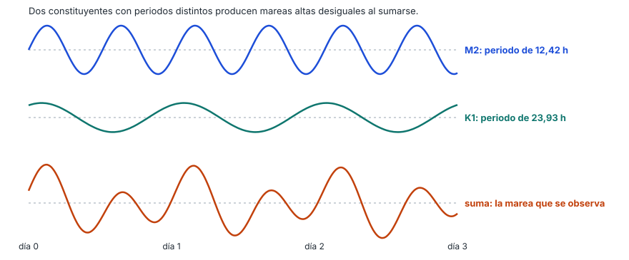
<figcaption aria-hidden="true">Dos constituyentes y su suma. Cada onda por separado es regular. La suma produce mareas altas de alturas distintas, como en una playa real.</figcaption>
</figure>

Los periodos dependen solo de la astronomía y son iguales en todo el planeta. Lo que cambia de un lugar a otro son dos números por onda. La amplitud es cuánto sube la onda sobre su nivel medio. El desfase dice a qué hora llega su máximo.

Esos dos números por constituyente, para un puerto, se llaman constantes armónicas. En Chile las publica el servicio hidrográfico de la Armada (SHOA).

Para predecir la marea de cualquier fecha hacen falta tres cosas: las constantes del lugar, la posición de la Luna y el Sol en esa fecha, y unas correcciones lentas, llamadas nodales (solo el nombre).

Los programas que hacen este cálculo se llaman de síntesis armónica. El de referencia en Python se llama pyTMD; otro se llama pyfes. Los dos son difíciles de instalar.

> [!NOTE]
>
> **Concepto: Corrección mareal**
>
> La corrección mareal traslada la orilla de cada imagen a la posición que tendría con un nivel del agua de referencia. Así las fechas se comparan como si todas tuvieran la misma marea.

<figure>
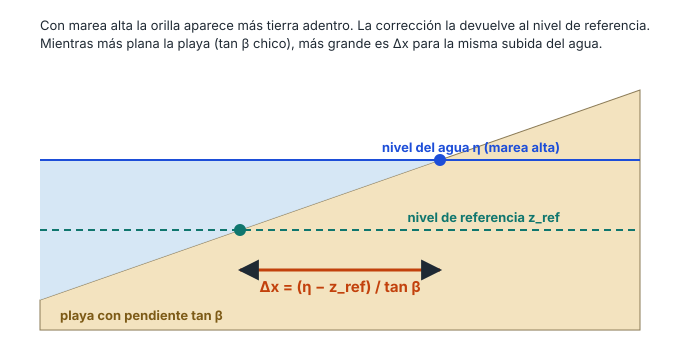
<figcaption aria-hidden="true">Perfil de una playa. Con la marea alta η, la orilla queda tierra adentro. La corrección Δx la devuelve al nivel de referencia, y crece cuando la playa es más plana.</figcaption>
</figure>

La idea es simple: si la playa sube 0,1 m por cada metro hacia tierra, para subir 0,5 m el agua tiene que avanzar 0,5 / 0,1 = 5 m. La fórmula del artículo (Ec. 2, p. 9) es:

$$\Delta x = \frac{\eta - z_\mathrm{ref}}{\tan\beta}, \qquad x_\mathrm{corr} = x_\mathrm{bruta} - \Delta x$$

Cada símbolo en palabras:

- $\eta$ (eta) es el nivel del agua en el momento de la imagen, en metros.
- $z_\mathrm{ref}$ es el nivel de referencia elegido, en metros.
- $\beta$ (beta) es el ángulo de inclinación de la playa, y $\tan\beta$ es la subida dividida por el avance: cuántos metros sube la playa por cada metro hacia tierra. Aquí basta esa división; no hace falta saber más de la tangente.
- $x_\mathrm{bruta}$ es la [distancia a lo largo del transecto](#c-chainage) medida en la imagen, y $x_\mathrm{corr}$ la corregida.

El signo de la segunda fórmula depende del sentido en que crece la distancia. En este material la distancia crece hacia el mar. Con marea alta la orilla queda más tierra adentro, así que la corrección la lleva hacia el mar y se suma: $x_\mathrm{corr} = x_\mathrm{bruta} + \Delta x$. El artículo escribe una resta; lo que no cambia es el tamaño de $\Delta x$.

A $\tan\beta$ se le llama «pendiente de la playa». En la sección siguiente aparece otra pendiente, la de una recta, en metros por año. Son cosas distintas con el mismo nombre.

> [!NOTE]
>
> **Ejemplo resuelto: corregir una distancia por la marea**
>
> Una imagen se tomó con el agua 0,5 m sobre la referencia. La playa sube 1 m por cada 10 m: $\tan\beta = 0{,}1$. La distancia medida es 120 m.
>
> 1.  $\Delta x = 0{,}5 / 0{,}1 = 5$ m.
> 2.  La marea alta dejó la orilla tierra adentro. La distancia crece hacia el mar, así que se suma: $x_\mathrm{corr} = 120 + 5 = 125$ m.
> 3.  La orilla queda 5 m más hacia el mar, donde estaría con la marea de referencia.

> [!NOTE]
>
> **Ejemplo para completar**
>
> 
>
> Otra playa es más plana: $\tan\beta = 0{,}025$. La marea está 0,5 m sobre la referencia. $\Delta x$ = \_\_\_\_ m. Comparada con la playa del ejemplo anterior, la corrección es \_\_\_\_ veces mayor.
>
> *[Respuesta E5](#r-ejer-5)*

## Rectas, ángulos y parecidos

> [!NOTE]
>
> **Concepto: Regresión lineal y R²**
>
> Una regresión lineal busca la recta que pasa más cerca de un conjunto de puntos. Su pendiente es la tendencia, y el R² dice qué fracción de la variación de los puntos explica la recta, de 0 (nada) a 1 (todo).

Es la versión con números de la [tendencia entre mediciones ruidosas](#c-tendencia-ruido) del nivel 0. En el eje horizontal va el tiempo, en años. En el vertical, la distancia a lo largo del transecto. La recta que mejor pasa por los puntos tiene una pendiente en metros por año. Esa pendiente es la tasa de cambio de la playa.

«Más cerca» tiene un sentido preciso: la recta hace mínima la suma de los cuadrados de las distancias verticales de los puntos a la recta. Por eso se llama de mínimos cuadrados.

Un R² bajo no dice que la tasa sea falsa. Dice que la mayor parte de lo que se mueve la orilla no sigue una recta: marea, temporadas, tormentas. Con cuarenta años de datos, una tasa puede ser clara aunque el R² sea bajo.

También se puede calcular un intervalo de confianza del 95 % para la pendiente. Es un rango que, con datos de este tipo, contiene la pendiente verdadera 95 veces de cada 100. Un intervalo ancho indica una tasa poco precisa.

> [!NOTE]
>
> **Ejemplo resuelto: la pendiente como tasa**
>
> Una recta ajustada a 40 años de datos de un transecto baja de 80 m en 1985 a 60 m en 2025.
>
> 1.  Cambio: 60 − 80 = −20 m.
> 2.  Tiempo: 2025 − 1985 = 40 años.
> 3.  Pendiente: −20 / 40 = −0,5 m por año. El signo negativo indica que la orilla se acerca al origen en tierra: retrocede.

> [!IMPORTANT]
>
> **Concepto umbral: Distancia oblicua**
>
> Si un transecto cruza la orilla con un ángulo θ respecto de la perpendicular, mide la distancia perpendicular dividida por cos θ, un número que vale 1 con θ = 0° y baja hacia 0 a medida que θ crece. Por eso el transecto oblicuo nunca mide menos que el desplazamiento perpendicular.

Volvamos a la huincha del nivel 0. Si la tiendes derecho al mar, un retroceso de 10 m se lee como 10 m. Si la tiendes en diagonal, la orilla la cruza más lejos, y el mismo retroceso se lee como más de 10 m.

La dirección perpendicular a la orilla se llama normal. El ángulo θ (theta) se mide entre el transecto y la normal. Cuando θ = 0 el transecto está perfectamente orientado.

<figure>
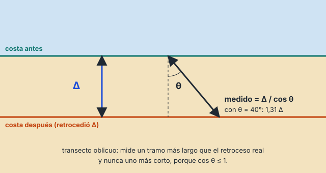
<figcaption aria-hidden="true">Retroceso perpendicular Δ y la distancia que mide un transecto que forma un ángulo θ con la normal. Con θ = 40°, el transecto mide 1,31 veces el retroceso.</figcaption>
</figure>

En la figura se forma un triángulo con un ángulo recto. Su lado corto vertical es el retroceso real, Δ. Su lado largo, el diagonal, es lo que mide el transecto. El coseno de θ es el lado corto que toca el ángulo θ dividido por el lado largo. Por eso:

$$\text{medido} = \frac{\Delta}{\cos\theta}$$

Algunos valores: cos 0° = 1; cos 20° ≈ 0,94; cos 30° ≈ 0,87; cos 35° ≈ 0,82; cos 40° ≈ 0,77; cos 45° ≈ 0,71; cos 60° = 0,5. Con 20° el error es de 6 %. Con 40° ya es de 31 %.

> [!NOTE]
>
> **Ejemplo resuelto: cuánto infla un ángulo de 40°**
>
> La orilla retrocede 10 m en dirección perpendicular. El transecto forma 40° con la normal.
>
> 1.  cos 40° ≈ 0,766.
> 2.  Medido = 10 / 0,766 ≈ 13,1 m.
> 3.  La tasa que se calcule con ese transecto saldrá 31 % más grande que la real.
> 4.  Visto al revés: para pasar de lo medido a lo real hay que multiplicar por 0,766, es decir, restar un 23 %. Inflar un 31 % y reducir un 23 % son la misma corrección vista desde los dos lados.
> 5.  En el nivel 4 aparece un ángulo así de grande en el artículo, pero como un error de medición, no como una propiedad de la costa.

> [!NOTE]
>
> **Ejemplo para completar**
>
> 
>
> Un transecto forma 30° con la normal (cos 30° ≈ 0,866). La orilla avanza 6 m hacia el mar. El transecto mide \_\_\_\_ m. La inflación es de \_\_\_\_ %.
>
> *[Respuesta E6](#r-ejer-6)*

> [!TIP]
>
> **Analogía**
>
> Es como cruzar una calle en diagonal. Llegas a la vereda del frente igual, pero caminas más que si cruzaras derecho. El ancho de la calle no cambió: cambió tu trayectoria.
>
> **Dónde falla:** al cruzar la calle sabes que la calle es recta y cuál es su dirección. En una costa curva, la «dirección derecha» depende de a qué escala mires la costa: la de una playa entera o la de los 200 m frente al transecto. El nivel 4 muestra que esa elección es justamente lo que el artículo no puede probar.

> [!WARNING]
>
> **Error común**
>
> **Se cree que** si los transectos están un poco torcidos, unos hacia un lado y otros hacia el otro, los errores se cancelan. **En realidad** no se cancelan. Un ángulo de +30° y uno de −30° alargan la medición igual. El ángulo negativo es el mismo ángulo inclinado hacia el otro lado: el triángulo es el mismo, reflejado, y cos(−30°) = cos 30°. La desalineación solo puede inflar las tasas, nunca achicarlas.

> [!NOTE]
>
> **Concepto: Correlación**
>
> La correlación, que se escribe $r$, mide cuánto se mueven juntas dos listas de números. Va de −1 (cuando una sube, la otra baja) a +1 (suben juntas); 0 indica que no hay relación lineal.

Si comparas la altura de padres e hijos, sale una correlación positiva: padres altos suelen tener hijos altos, aunque no siempre. La correlación no dice cuánto sube una por cada unidad de la otra. Eso lo dice la pendiente de la [regresión](#c-regresion). La correlación dice qué tan ordenada es la relación.

En el artículo se usa la correlación para preguntar si dos mediciones del mismo ángulo coinciden. Por ejemplo, si el ángulo de un transecto se parece al de su vecino, o si el ángulo medido con datos de una época se parece al medido con datos de otra.

**Pregunta 8 · recuperación**

¿Por qué el MNDWI es alto sobre el agua?

*[Respuesta 8](#r-preg-8)*

**Pregunta 9 · recuperación**

¿Qué tres cosas hacen falta para predecir la marea de un lugar en una fecha?

*[Respuesta 9](#r-preg-9)*

**Pregunta 10 · aplicación**

En una playa de pendiente 0,05, una imagen se tomó con el agua 0,2 m bajo la referencia. ¿De qué tamaño es la corrección, y la orilla de esa imagen está más hacia el mar o más hacia tierra que la de referencia?

*[Respuesta 10](#r-preg-10)*

**Pregunta 11 · repaso**

Usando el nivel 0 y este nivel: dos transectos vecinos forman +35° y −35° con la normal. Un colega dice que, en promedio, la tasa de la zona sale bien. ¿Tiene razón?

*[Respuesta 11](#r-preg-11)*

**Pregunta 12 · explícalo con tus palabras**

Explica con tus palabras por qué la línea de costa del método se mueve si cambias el umbral, aunque la playa sea la misma.

*[Respuesta 12](#r-preg-12)*

> [!TIP]
>
> **En pocas palabras**
>
> El MNDWI convierte dos bandas en un número que separa agua de tierra. Otsu elige el umbral y el contorno subpíxel ubica la orilla entre centros de píxel. La marea se predice sumando ondas y se corrige con la pendiente de la playa. Un transecto oblicuo siempre infla la medición por 1/cos θ.

# Nivel 3 · Los métodos que el artículo da por sabidos

> [!NOTE]
>
> **Al terminar este nivel podrás**
>
> - Describir las etapas de la cadena de CoastSat, de la imagen a la línea de costa.
> - Calcular NSM, SCE y EPR para una serie corta de distancias, e interpretar la LRR y la WLR.
> - Explicar cómo se cruza una línea de costa con un transecto y cuándo se descarta el cruce.
> - Distinguir una prueba de equivalencia de una medición de exactitud.
> - Explicar qué es una distribución nula y por qué una cantidad rectificada la necesita.
> - Explicar qué controla una prueba de permutación.

Este nivel junta las piezas del nivel 2 en los métodos que usa el campo. Termina con tres herramientas estadísticas que el artículo usa para no engañarse.

## La cadena de referencia

> [!NOTE]
>
> **Concepto: Cadena de CoastSat**
>
> CoastSat es un conjunto de programas en Python que extrae líneas de costa de imágenes de satélite y es el estándar de hecho en el campo (Vos et al. 2019). Su cadena es: máscara de nubes, clasificación de píxeles, umbral de Otsu sobre el MNDWI restringido a arena y agua, contorno subpíxel y filtros sobre el contorno.

Cada etapa usa una pieza del nivel 2:

1.  Lee la imagen y su [máscara de nubes](#c-mascara-nubes). Limpia la máscara: borra las manchas de nube muy chicas, que suelen ser espuma mal marcada.
2.  Calcula el [MNDWI](#c-mndwi) de cada píxel.
3.  Clasifica cada píxel en arena, agua, espuma u otro con el [clasificador](#c-clasificador).
4.  Calcula el [umbral de Otsu](#c-otsu) usando solo píxeles de arena y de agua cercanos a una línea de costa de referencia.
5.  Traza el [contorno subpíxel](#c-contorno-subpixel) del MNDWI en ese umbral.
6.  Borra los tramos del contorno cercanos a nubes o a píxeles sin datos, y los tramos demasiado cortos.

Después, CoastSat cruza las líneas con transectos y entrega, por cada transecto, una serie de distancias en el tiempo.

Una evaluación entre varios grupos de investigación ubica la exactitud de este tipo de métodos en unos 7 a 10 m frente a mediciones de terreno (Vos et al. 2023).

Hay otras herramientas. CoastSeg envuelve a CoastSat en una interfaz web (Fitzpatrick et al. 2024). SHOREX es otra familia de métodos, de un grupo español, que ubica la orilla de otra forma (Sánchez-García et al. 2020). Para este material son solo nombres.

Los autores del artículo usaron CoastSat antes, en un estudio nacional de erosión de la costa de Chile. El artículo llama a ese trabajo «el estudio de referencia». Sus transectos, tasas y tablas guardadas sirven como el original contra el que se compara strandline.

CoastSat tiene tres costos que no vienen del método sino de cómo está construido. Es lento en la etapa de cruzar líneas con transectos. Depende de muchas piezas externas. Y la predicción de marea exige paquetes difíciles de instalar. El artículo parte de esos tres costos.

> [!NOTE]
>
> **Concepto: Otsu balanceado**
>
> El Otsu balanceado calcula el umbral entre dos clases, arena y agua, dando a ambas el mismo peso, aunque una tenga muchos más píxeles que la otra. Sin balance, la clase más numerosa arrastra el umbral hacia su lado.

En una escena de costa suele haber muchos más píxeles de mar que de arena. Si Otsu usa todos, el monte del agua domina el histograma. El umbral queda mal ubicado para separar justamente la arena.

Hay dos formas de balancear. CoastSat toma al azar tantos píxeles de agua como de arena. Esa elección al azar hace que dos corridas puedan dar umbrales algo distintos. La otra forma, la que usa el artículo, da a cada clase la mitad del peso en el cálculo, sin sacar nada al azar. Con los mismos datos, da siempre el mismo umbral.

## De las líneas a las tasas

> [!NOTE]
>
> **Concepto: Intersección con franja**
>
> La intersección con franja calcula la distancia a lo largo de un transecto usando los vértices de la línea de costa que caen en una franja angosta alrededor de él. Cada vértice se proyecta sobre el transecto, y un control descarta el cruce si los valores son demasiado dispersos o escasos.

Una línea de costa digital es una lista de puntos, llamados vértices, unidos por tramos rectos. CoastSat entrega la línea así, y también strandline. Para cada transecto, el método:

1.  Toma los vértices a menos de una cierta distancia del eje del transecto, por ejemplo 25 m a cada lado. Eso forma la franja.
2.  Proyecta cada vértice sobre el transecto, como si bajara una perpendicular. Cada proyección da una [distancia a lo largo del transecto](#c-chainage).
3.  Resume esas distancias en un solo número, por ejemplo con su mediana.
4.  Descarta el cruce si las distancias varían mucho, si se reparten en un rango muy amplio o si hay muy pocos vértices.

A veces la línea cruza el transecto dos veces, por ejemplo cuando hay una laguna detrás de la playa. Una regla decide qué hacer: elegir un cruce de forma automática, quedarse con el más lejano o declarar el valor como faltante.

El paso se repite para cada transecto y cada fecha. Con 250 transectos y 200 fechas son 50 000 cruces. En CoastSat el cálculo recorre los transectos uno por uno en Python, y eso es lo que lo hace lento.

Para su estudio de referencia, los autores ya habían reescrito este paso en Python de una forma mucho más rápida, llamada vectorizada (se explica más abajo). Esa versión es la que el artículo usa como referencia de velocidad.

> [!NOTE]
>
> **Concepto: Tasas de cambio**
>
> Las tasas de cambio resumen la serie de distancias de un transecto en números de metros o de metros por año. Las principales son NSM, SCE, EPR, LRR y WLR, definidas originalmente en la herramienta DSAS del Servicio Geológico de Estados Unidos.

Cada una responde una pregunta distinta:

| Sigla | Nombre en inglés           | Qué mide                                                                        |
|-------|----------------------------|---------------------------------------------------------------------------------|
| NSM   | Net Shoreline Movement     | Distancia de la última fecha menos la de la primera, en m.                      |
| SCE   | Shoreline Change Envelope  | Mayor distancia menos la menor, en m: cuánto se movió en total.                 |
| EPR   | End-Point Rate             | NSM dividido por los años entre la primera y la última fecha, en m/año.         |
| LRR   | Linear Regression Rate     | Pendiente de la [regresión lineal](#c-regresion) de todas las fechas, en m/año. |
| WLR   | Weighted Linear Regression | Pendiente de una regresión donde cada fecha pesa según su confianza, en m/año.  |

La EPR usa solo dos fechas y es sensible a que una de ellas sea rara. La LRR usa todas, y una fecha rara la mueve poco: es más robusta.

La WLR da más voz a las fechas más confiables. Es la misma regresión de mínimos cuadrados, pero al sumar los cuadrados de las distancias cada punto se multiplica por su peso. Un punto con peso 2 cuenta como dos puntos.

Ojo con la palabra «peso»: aquí significa cuánto cuenta una fecha en la recta. No tiene relación con los pesos de la red neuronal del nivel 2.

> [!NOTE]
>
> **Ejemplo resuelto: cinco fechas, cuatro tasas**
>
> Distancias de un transecto: 1990: 100 m; 2000: 96 m; 2005: 110 m; 2010: 92 m; 2020: 85 m.
>
> 1.  NSM = 85 − 100 = −15 m.
> 2.  SCE = 110 − 85 = 25 m.
> 3.  EPR = −15 / 30 = −0,5 m/año.
> 4.  LRR: la pendiente de la recta de mínimos cuadrados por los cinco puntos. Calcularla a mano es largo; un programa la da en unos −0,5 m/año. La medida de 2005 queda muy por encima de la recta, pero no la decide sola.

> [!NOTE]
>
> **Ejemplo para completar**
>
> 
>
> Otro transecto: 1990: 50 m; 2000: 50 m; 2010: 70 m; 2020: 50 m. NSM = \_\_\_\_ m. SCE = \_\_\_\_ m. EPR = \_\_\_\_ m/año. ¿La playa avanzó o se quedó igual? \_\_\_\_.
>
> *[Respuesta E7](#r-ejer-7)*

> [!IMPORTANT]
>
> **Se corrige la simplificación**
>
> En el nivel 1 dijimos que cada transecto cruza la orilla en ángulo recto. Ya sabes calcular por qué importa que no sea así: la distancia medida se divide por cos θ. Los transectos se generan una vez, perpendiculares a la línea de referencia. La orilla de otra fecha puede tener otra forma y cruzarlos en diagonal. El nivel 4 mide cuánto.

> [!NOTE]
>
> **Concepto: Pesos por sensor**
>
> Los pesos por sensor son números que dicen cuánto confiar en cada observación de la WLR según el satélite que la tomó. Un sensor más preciso recibe más peso, para que sus fechas pesen más en la pendiente.

La forma habitual es una tabla fija. Por ejemplo, el estudio de referencia del artículo usa peso 1/15 para Landsat 5 y 7, 1/10 para Landsat 8 y 9, y 1/7 para Sentinel-2. Los números 15, 10 y 7 son el error típico que se supone para cada sensor, en metros, y el peso es 1 dividido por ese error. Esa tabla supone que los sensores más nuevos son más precisos, y que esa diferencia es la misma en todas las costas.

La alternativa es medir la precisión con los propios datos:

1.  Quitar la tendencia de cada transecto, restando su recta.
2.  Juntar lo que sobra, los residuos, separados por satélite y sumando todos los transectos.
3.  Calcular cuánto varían los residuos de cada satélite.
4.  Dar a cada satélite un peso igual a 1 dividido por esa varianza. Fíjate en la diferencia: la tabla fija divide por el error, y esta forma divide por el error al cuadrado.

Un satélite con residuos que varían poco recibe mucho peso.

> [!WARNING]
>
> **Error común**
>
> **Se cree que** si los pesos calibrados con los datos dan una WLR distinta a la de la tabla fija, los pesos calibrados están mal. **En realidad** la WLR de la tabla fija no es una medición: es el resultado de una suposición. Parecerse a ella mide el parecido a una suposición, no la exactitud. Para saber cuál es mejor hace falta una tasa medida de forma independiente, por ejemplo en terreno.

> [!NOTE]
>
> **Concepto: Control de calidad**
>
> El control de calidad de transectos es un conjunto de reglas que marca como poco confiable un transecto cuyas tasas no se pueden creer. El artículo usa cinco criterios en un orden fijo, y anota el primero que falla como la razón.

Los cinco criterios del estudio de referencia (Sec. 2.6, p. 11) son:

1.  La LRR no supera 5 m/año en valor absoluto.
2.  El SCE no supera 500 m.
3.  La serie abarca al menos 20 años.
4.  Hay al menos 50 observaciones válidas.
5.  El R² es al menos 0,01.

Los transectos que pasan se clasifican como en erosión, estables o en acreción. Acreción es lo contrario de erosión: la playa gana arena y avanza hacia el mar. El corte está en ±0,5 m/año: bajo −0,5 hay erosión y sobre +0,5, acreción.

## Rapidez sin cambiar el resultado

> [!NOTE]
>
> **Concepto: Paralelismo determinista**
>
> Paralelizar es repartir un cálculo entre varios núcleos del procesador para que terminen antes. El paralelismo es determinista cuando el resultado es idéntico, bit a bit, al del cálculo en un solo núcleo.

El procesador es la parte del computador que hace las cuentas. Uno moderno tiene varios núcleos, que son como varios procesadores chicos trabajando a la vez. El del artículo tiene 12 núcleos, que corren 16 tareas al mismo tiempo, llamadas hilos: algunos núcleos atienden dos hilos a la vez.

Si cada transecto es independiente de los otros, se pueden repartir los transectos entre los hilos. Eso es paralelizar.

Vectorizar es otra idea: escribir el cálculo como una sola operación sobre una lista entera de datos, en vez de un ciclo que los recorre uno por uno. La referencia en Python del artículo ya estaba vectorizada; strandline además paraleliza.

Paralelizar tiene una trampa. Los computadores guardan cada número con una cantidad fija de decimales y redondean el resto. Por eso el orden de una suma importa. Imagina un computador que guarda solo cuatro cifras. Si suma 1000 + 0,4 obtiene 1000,4, lo redondea a 1000, y al sumar otro 0,4 vuelve a quedar en 1000. Si primero suma 0,4 + 0,4 = 0,8 y después agrega 1000, obtiene 1000,8, que redondea a 1001.

Al paralelizar, cada hilo suma su parte y después se juntan las partes, así que el orden de las sumas cambia. Un programa paralelo descuidado puede dar resultados algo distintos cada vez que corre.

Un bit es la unidad mínima con que el computador guarda un número, un 0 o un 1. Que dos resultados sean idénticos bit a bit quiere decir que coinciden hasta el último decimal guardado. El artículo afirma que sus salidas paralela y secuencial son idénticas bit a bit. Se puede compilar una versión sin paralelismo para comprobarlo.

> [!NOTE]
>
> **Concepto: Prueba de equivalencia**
>
> Una prueba de equivalencia compara la salida de un programa con la de una implementación de referencia, con las mismas entradas, para mostrar que hacen el mismo cálculo. No dice si el cálculo es correcto respecto del mundo real.

Es la [copia fiel](#c-copia-fiel) del nivel 0, con números. Para cada etapa se elige el objeto que define la respuesta correcta: la red original de scikit-learn para el clasificador, las tablas guardadas del estudio de referencia para las tasas, pyTMD para la marea. Después se mide la diferencia.

La diferencia se informa con su resumen: la mediana, la diferencia máxima o el número de casos que no coinciden. Una diferencia del orden del redondeo, como 0,00005 m, indica que los dos programas hacen la misma cuenta.

El valor de estas pruebas es que separan dos preguntas. Si el programa nuevo hace lo mismo que el viejo, cualquier diferencia posterior se debe a una elección deliberada y no a un error de copia.

> [!WARNING]
>
> **Error común**
>
> **Se cree que** una coincidencia de 0,2 m con CoastSat significa que la línea de costa está a 0,2 m de la orilla real. **En realidad** significa que los dos programas ponen la línea casi en el mismo lugar. Si los dos se equivocan igual, coinciden igual. La exactitud frente a la orilla real es otra medición, que necesita datos de terreno.

## Ajustar dentro de la imagen

> [!NOTE]
>
> **Concepto: Ajuste de perfil**
>
> Un ajuste de perfil lee el MNDWI a lo largo de una línea corta que cruza la orilla, y ajusta a esos valores una curva en forma de S que sube de tierra a agua. La orilla se ubica en la mitad de la subida de la curva.

Si caminas desde la duna hacia el mar y anotas el MNDWI cada pocos metros, los valores parten bajos, suben en la orilla y quedan altos en el agua. Una curva en S, llamada sigmoide, describe bien esa forma.

Ajustar la curva es buscar la S que pasa más cerca de esos valores, como la regresión busca la recta. Usa todos los valores del recorrido y no solo los dos píxeles vecinos al umbral.

El tramo de la línea donde se leen los valores se llama ventana de muestreo; por ejemplo, unas decenas de metros alrededor de una orilla aproximada, como la que da el contorno.

El ajuste tiene una condición: la línea de muestreo tiene que cruzar la orilla de frente. Si la cruza en diagonal, la subida de tierra a agua se estira a lo largo de la línea, por el mismo factor 1/cos θ del nivel 2. Una subida estirada puede quedar en parte fuera de la ventana.

> [!TIP]
>
> **Analogía**
>
> Es como medir la pendiente de una escalera caminando por ella. Si subes de frente, cuentas bien los peldaños por metro. Si la cruzas en diagonal, cada peldaño parece más largo y la escalera, más suave.
>
> **Dónde falla:** en la escalera sabes dónde está el frente. En una imagen, la dirección de frente a la orilla de esa fecha hay que estimarla, y depende de la forma de la costa ese día.

## Tres herramientas para no engañarse

> [!IMPORTANT]
>
> **Concepto umbral: Distribución nula**
>
> Una distribución nula es lo que daría una medición si el efecto que buscas no existiera. Se obtiene aplicando el mismo procedimiento a datos donde sabes que el efecto es cero, y la señal es lo que sobresale de ella.

Supón que pesas una manzana en una balanza de cocina y marca 210 g. Antes de creerlo, pones la balanza vacía: si marca 15 g, la manzana pesa 195 g. La balanza vacía es la nula: lo que marca el instrumento cuando no hay nada.

En estadística se hace lo mismo con cualquier medición. Antes de decir «encontré un ángulo de 8°», preguntas: ¿cuánto marcaría mi método si el ángulo verdadero fuera 0°? Si marcaría 7°, casi todo es ruido. Si marcaría 1°, la mayor parte es real.

<figure>
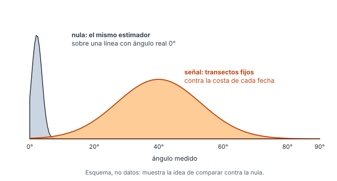
<figcaption aria-hidden="true">Esquema de una señal contra su nula. La nula es la distribución que da el estimador cuando el ángulo verdadero es 0°. La señal vale como hallazgo solo en la medida en que se separa de ella.</figcaption>
</figure>

Para comparar las dos distribuciones se usa una prueba estadística; la del artículo se llama de Mann-Whitney (solo el nombre). Esa prueba entrega un valor $p$: la probabilidad de ver una separación así de grande si las dos distribuciones fueran en realidad la misma. Un $p$ casi cero indica que la diferencia no es casualidad.

> [!WARNING]
>
> **Error común**
>
> **Se cree que** basta con que la medición de control dé un número bajo. **En realidad** lo que importa es la forma completa de lo que da el método cuando la verdad es cero. Un control con mediana baja puede tener una cola larga que se confunda con la señal. Por eso se compara la señal con toda la distribución nula, no con un solo número.

> [!NOTE]
>
> **Concepto: Cantidad rectificada**
>
> Una cantidad rectificada es una medida a la que se le quitó el signo, como un valor absoluto o un ángulo entre 0° y 90°. Sus errores no se cancelan: el ruido la hace crecer en promedio, aunque el valor verdadero sea cero.

Si mides diez veces algo que vale cero, con un error de ±3, obtienes números como +2, −3, +1, −1. Su promedio se acerca a cero. Pero si a cada uno le quitas el signo, obtienes 2, 3, 1, 1, y el promedio queda cerca de 2. El ruido se convirtió en una señal falsa.

El ángulo del artículo es así. El estimador lee la dirección de la costa en un tramo alrededor del cruce y la compara con la dirección del transecto. La fórmula exacta del artículo, $\theta = \arcsin|\hat{u}\cdot\hat{t}|$, no hace falta saber leerla. Lo que importa es la barra vertical $|\ |$: es un valor absoluto. Por eso el ángulo sale siempre entre 0° y 90°, sin signo, y eso lo rectifica.

Por eso un estimador de ángulo con ruido dará varios grados aunque el ángulo verdadero sea cero. La [distribución nula](#c-nula) dice cuántos.

Para el ángulo, el artículo arma la nula así: aplica el mismo estimador a la línea de referencia de la que salieron los transectos. Sobre esa línea, el ángulo verdadero es cero por construcción, porque los transectos se dibujaron perpendiculares a ella. Todo lo que mida ahí el estimador es ruido.

> [!NOTE]
>
> **Concepto: Prueba de permutación**
>
> Una prueba de permutación mide qué tan grande puede salir un estadístico por casualidad, desordenando los datos al azar muchas veces y recalculándolo. Si el valor real queda fuera del rango de los desordenados, no se explica por azar.

Supón que quieres saber si el ángulo de un transecto se parece al de su vecino. Calculas la [correlación](#c-correlacion) entre cada transecto y el siguiente a lo largo de la costa. Te da 0,6. ¿Es mucho?

Para saberlo, barajas el orden de los transectos como un mazo de cartas y recalculas la correlación entre vecinos. Ahora los «vecinos» son pares al azar. Repites mil veces. Si el 95 % de las veces la correlación queda entre −0,2 y +0,2, ese es el rango del azar. Un 0,6 queda muy fuera.

La misma correlación se puede calcular entre transectos separados por 2, 5 o 20 posiciones, no solo entre vecinos inmediatos. Si el ángulo es una propiedad real de la costa, debería parecerse entre transectos cercanos y dejar de parecerse entre transectos lejanos.

Si el ángulo fuera solo ruido del estimador, y el error de cada transecto no dependiera del de su vecino, no se parecería a ninguna distancia. Ese supuesto de independencia es razonable, pero no es seguro: transectos vecinos se miden sobre las mismas imágenes.

**Pregunta 13 · recuperación**

¿Qué diferencia hay entre la EPR y la LRR?

*[Respuesta 13](#r-preg-13)*

**Pregunta 14 · recuperación**

¿Cómo se construye la distribución nula del ángulo entre transecto y costa?

*[Respuesta 14](#r-preg-14)*

**Pregunta 15 · repaso**

Usando el nivel 2: un estimador de ángulo da una mediana de 4° sobre una línea con ángulo verdadero 0°. ¿Por qué no da 0°? Y si sobre transectos reales mide 8°, ¿qué parte de esos 8° puedes atribuir a un ángulo real?

*[Respuesta 15](#r-preg-15)*

**Pregunta 16 · explícalo con tus palabras**

Explica por qué una coincidencia casi perfecta con CoastSat no prueba que strandline sea exacto.

*[Respuesta 16](#r-preg-16)*

**Pregunta 17 · aplicación**

Calculas la correlación de un ángulo entre transectos vecinos y da 0,05. Las permutaciones dan un rango de ±0,2. ¿Qué concluyes?

*[Respuesta 17](#r-preg-17)*

> [!TIP]
>
> **En pocas palabras**
>
> CoastSat es la cadena de referencia: clasifica, umbraliza, contornea y cruza con transectos. Las tasas resumen cada transecto, y el control de calidad descarta los no confiables. Para no engañarse hacen falta pruebas de equivalencia para la fidelidad, una nula para las cantidades rectificadas y permutaciones para la estructura espacial.

# Nivel 4 · Lo que aporta el manuscrito y lo que deja abierto

> [!NOTE]
>
> **Al terminar este nivel podrás**
>
> - Enunciar las cinco afirmaciones centrales del manuscrito y su límite principal, con su grado de certeza.
> - Explicar cómo se demostró cada una y con qué evidencia.
> - Explicar por qué una referencia desviada produce un ángulo falso que pasa las pruebas de coherencia.
> - Enumerar los límites que el manuscrito declara y los que no resuelve.

Este nivel lee el artículo con todo lo anterior. Cada afirmación va con el lugar exacto del manuscrito donde está. Al final hay una sección con lo que el artículo no demuestra.

## El motor

> [!NOTE]
>
> **Concepto: strandline**
>
> strandline es el programa que presenta el artículo: un motor compilado, escrito en Rust, que copia la cadena de CoastSat y le agrega síntesis de marea, intersección paralela de transectos y tasas con control de calidad. Se instala como un solo binario, que al correr no necesita Python ni bibliotecas numéricas externas.

El motor tiene dos partes. Una biblioteca guarda todos los cálculos. Un programa de línea de comandos los ofrece como once subcomandos que se pueden encadenar: `fetch` baja imágenes, `extract` extrae la línea, `transects` genera transectos, `intersect` los cruza, `tide` predice la marea, `rates` calcula tasas, y otros más. La lectura de imágenes, el manejo de coordenadas y las tablas de números vienen de un motor geoespacial hermano, `surtgis-core`. Todo lo demás está escrito dentro de strandline (Sec. 2, p. 6-7).

<figure>
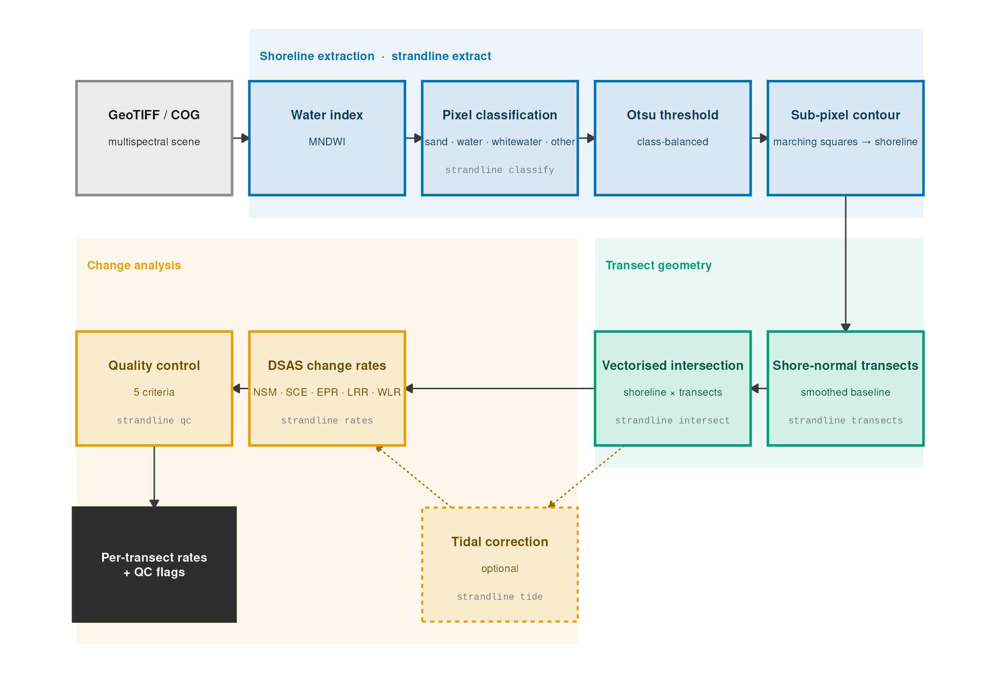
<figcaption aria-hidden="true">La cadena de strandline, del original del manuscrito (Fig. 1). Azul: extracción de la línea. Verde: geometría de transectos. Naranja: análisis de cambio. La corrección mareal, en línea punteada, es opcional.</figcaption>
</figure>

El objetivo declarado es doble: hacer lo mismo que CoastSat y hacerlo más rápido y con menos piezas externas. El artículo insiste en el orden: primero mostrar que el resultado no cambia, después medir la velocidad (Sec. 4, p. 14).

> [!NOTE]
>
> **En el manuscrito (Resumen, p. 2-3; Sec. 2.2-2.6, p. 8-12; Sec. 5.1, p. 20)**
>
> **El motor reproduce a CoastSat etapa por etapa.** Cada etapa se compara con el objeto que define su respuesta. Son [pruebas de equivalencia](#c-equivalencia), no mediciones de exactitud (Sec. 4.1, p. 15):
>
> - **Clasificación.** El conteo de píxeles por clase coincide con CoastSat a menos de 1,5 % en una escena de prueba (Sec. 2.2, p. 8).
> - **Línea de costa.** En seis escenas TOA de Viña del Mar, con el clasificador y un modo de strandline que replica el cálculo del umbral de CoastSat, la mediana de la distancia entre la línea de strandline y la de CoastSat es 0,30-0,35 m. La distancia se mide desde cada punto de una línea hasta la otra línea, en los dos sentidos. Con el tratamiento de nubes (limpiar la máscara y borrar la línea cerca de las nubes) baja a 0,20 m, con media de 3,3 m y percentil 90 de 1,2 m (Sec. 5.1, p. 20). Que la media supere al percentil 90 no es un error: unos pocos puntos muy lejanos suben la media, como el error de 76 m del nivel 1. Las dos líneas se calcularon sobre la misma imagen de 15 m.
> - **Marea.** La síntesis armónica coincide con pyTMD, el paquete de referencia en Python, a un error máximo de 1,15 mm, con 13 constituyentes realistas de Chile central (Sec. 2.4, p. 9-10; Sec. 5.3, p. 22). La [corrección mareal](#c-correccion-mareal) reproduce exactamente la serie corregida del estudio de referencia.
> - **Transectos, tasas y [control de calidad](#c-control-calidad).** Los transectos generados reproducen los del estudio de referencia a 0,0 m (Sec. 2.5, p. 10). Las tasas coinciden a nivel de redondeo, por ejemplo NSM, SCE y EPR a 0,00005 m. El control de calidad da cero diferencias en la marca de exclusión y en la razón, sobre 179 transectos (Sec. 2.6, p. 12).

Dos precisiones del propio artículo acotan la afirmación. La exactitud de la marea es la del cálculo dados los constituyentes correctos. Con constituyentes aproximados, la predicción es tan buena como ellos (Sec. 2.4, p. 10). Y con imágenes SR de 30 m bajadas por internet desde catálogos públicos, la mediana contra CoastSat sube a 9,35 m. El artículo la presenta como una comparación entre productos distintos, SR de 30 m contra TOA de 15 m, que equivale a 0,3 píxeles (Sec. 5.1, p. 20).

> [!NOTE]
>
> **Concepto: Divergencias documentadas**
>
> Las divergencias documentadas son los puntos donde strandline, a propósito, no hace lo mismo que CoastSat. El artículo los declara para que las diferencias que quedan en los resultados se puedan atribuir a una causa y no se confundan con errores de copia.

El artículo declara cuatro, todas en la extracción de la línea (Sec. 4.2, p. 15-17):

1.  **Dónde se calcula el umbral.** CoastSat calcula el [Otsu balanceado](#c-otsu-balanceado) solo cerca de una línea de referencia y balancea sacando píxeles al azar. strandline usa toda la escena y balancea con pesos, sin azar. Es la diferencia de mayor efecto: donde hay arena clara tierra adentro, como dunas o lechos de ríos secos, las dos muestras son distintas.
2.  **Píxeles sin valor definido.** En sombras profundas, la suma de un índice puede dar cero y el índice queda sin valor. CoastSat reemplaza esos valores por un número diminuto y clasifica el píxel igual. strandline los manda a la clase «otro», porque la red nunca vio ese número de relleno.
3.  **Poca arena.** Si hay menos de 50 píxeles de arena, CoastSat cambia solo a un Otsu sin clasificador. strandline no cambia solo. El usuario elige el modo sin clasificador cuando corresponde.
4.  **Cercanía a píxeles sin datos.** Los dos programas borran vértices a menos de 30 m de un píxel sin datos. La distancia de strandline se lee en el píxel más cercano al vértice, y el corte efectivo puede quedar hasta 0,71 píxeles más corto, que es media diagonal de un píxel.

Ninguna de las cuatro afecta los transectos, las tasas o el control de calidad, que reproducen las tablas de referencia.

> [!NOTE]
>
> **En el manuscrito (Sec. 7, p. 36)**
>
> **Límite principal: el clasificador solo sirve con TOA.** El [clasificador](#c-clasificador) de CoastSat se entrenó con [reflectancia TOA](#c-toa-sr). Con reflectancia de superficie (SR) etiqueta mal una fracción grande de píxeles. Por eso, con imágenes SR, el motor usa un umbral de Otsu refinado sin clasificador. En el motor, refinado quiere decir un Otsu sobre toda la imagen, repetido después solo en una franja alrededor del primer contorno; el artículo no da ese detalle.
>
> Los autores intentaron reentrenar el clasificador con etiquetas automáticas, puestas por reglas simples sobre los índices y no por una persona. Funcionó en costas templadas y húmedas, y falló en las áridas, donde el suelo claro del desierto es casi igual a la arena de playa en sus bandas. Un clasificador SR bien entrenado necesitaría etiquetado a mano y queda como trabajo futuro. El artículo señala que el campo no tiene uno público.

## La velocidad

> [!NOTE]
>
> **Concepto: Razón intercalada**
>
> La razón intercalada (aquí «razón» es un cociente de tiempos; en el control de calidad, «razón» era el motivo de exclusión) es la forma en que el artículo mide cuántas veces más rápido es su motor: alterna una corrida de cada programa en cada repetición y calcula la razón de tiempos dentro de cada repetición. Así una carga pasajera del computador afecta a los dos lados por igual.

Medir velocidad es más difícil de lo que parece. Si el computador hace otra cosa justo cuando corre Python, Python parece más lento, y el motor nuevo parece más rápido de lo que es. El artículo toma tres decisiones (Sec. 4.4, p. 18-19):

1.  Repite cada medición 21 veces y descarta las tres primeras, que suelen ser más lentas mientras el computador termina de cargar el programa y los datos en memoria.
2.  Alterna los programas en cada repetición, en vez de correr 21 veces uno y después 21 veces el otro.
3.  Calcula la razón en cada repetición y resume las razones con su mediana y su [rango intercuartílico](#c-resumen-estadistico) (IQR). Acepta una corrida solo si el IQR de cada razón queda dentro del 20 % de su mediana.

La segunda decisión resultó la decisiva. Dos corridas independientes cuyos tiempos de Python diferían 13 % dieron razones que coincidían a 0,1 %. Los tiempos sueltos varían. La razón, medida así, casi no varía.

> [!NOTE]
>
> **En el manuscrito (Sec. 5.2 y Tabla 2, p. 20-21; Sec. 2.4, p. 9-10)**
>
> **El paso más lento corre cientos de veces más rápido, sin cambiar el resultado.** Sobre 250 transectos y 200 líneas de costa sintéticas, fabricadas para la prueba, la [intersección con franja](#c-interseccion) tarda (Tabla 2, p. 21):
>
> | Configuración                    | Tiempo  | Razón |
> |----------------------------------|---------|-------|
> | Referencia vectorizada en Python | 7,34 s  | —     |
> | strandline, 16 hilos             | 0,027 s | 280   |
> | strandline, 1 hilo               | 0,201 s | 37    |
> | strandline, comando completo     | 0,132 s | 56    |
>
> La razón dice cuántas veces más rápido es strandline. La fila de un hilo mide la traducción a Rust sin la ayuda del paralelismo. La última cobra al motor el tiempo de arrancar y de leer y escribir archivos, que la referencia en Python no paga. Las salidas en paralelo y en un solo hilo son idénticas bit a bit ([paralelismo determinista](#c-paralelo-determinista); Sec. 5.2, p. 21). El motor se instala con un comando y no necesita pyTMD ni pyfes. Sintetiza la marea él mismo, a partir de las constantes de los [constituyentes](#c-constituyentes) que el usuario le entrega en un archivo (Sec. 2.4, p. 9-10).

La referencia en Python ya era una versión vectorizada, mucho más rápida que el ciclo original de CoastSat. Ese ciclo tardaba más de 20 minutos en un sitio con unos 180 transectos y 800 líneas (Sec. 1, p. 4). La extracción también es más rápida: sin clasificador, unos 18 milisegundos (ms, milésimas de segundo) por escena contra 1,17 s de CoastSat. Con clasificador, la ventaja baja a unas 6 veces (Sec. 5.2, p. 21).

> [!WARNING]
>
> **Error común**
>
> **Se cree que** «280 veces más rápido» significa que todo el análisis de una costa termina 280 veces antes. **En realidad** la cifra es de un solo paso, la intersección, comparado contra el mismo cálculo en Python. Otros pasos ganan menos: la extracción con clasificador gana unas 6 veces. La cifra del paso completo desde la línea de comandos es 56.

## Seis costas de prueba

Los resultados se obtienen en seis sitios de Chile, desde Arica (18,5° S) hasta Chiloé (42,5° S). Hay costas de desierto, estuarios (desembocaduras de ríos donde se mezclan agua dulce y salada), una costa urbana y un archipiélago (un grupo de islas) con mareas grandes. Dos sitios tuvieron terremotos, en los que el terreno subió o bajó de golpe y la línea de costa saltó de lugar: Maule 2010 en Constitución e Illapel 2015 en Coquimbo. Cada sitio tiene entre 392 y 1228 imágenes y entre 100 y 334 transectos (Tabla 1, p. 15).

<figure>
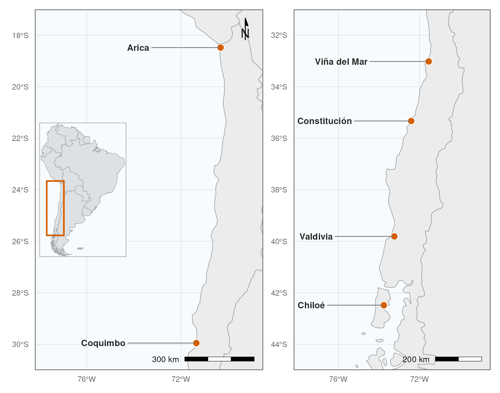
<figcaption aria-hidden="true">Los seis sitios de prueba a lo largo de Chile, del original del manuscrito (Fig. 2).</figcaption>
</figure>

## Dos versiones de los mismos transectos

> [!NOTE]
>
> **Concepto: Referencia desviada**
>
> Una referencia desviada es una línea de referencia que, por error, se fue tierra adentro y sigue la orilla de un estuario, una laguna o un río en vez de la costa del mar. Los transectos generados desde ella miden esas orillas interiores, y sus series pasan los controles habituales como si fueran de la playa.

En el estudio de referencia, la línea de referencia de cada sitio salió de las mismas líneas de costa detectadas en las imágenes. Donde había agua interior cerca, esa línea se desvió. Un reanálisis posterior de los mismos sitios encontró que en tres de ellos (Viña del Mar, Constitución y Valdivia) la mayoría de los transectos no medía la costa del mar, y que Coquimbo estaba afectado en parte (Sec. 3, p. 13-14).

El reanálisis rehízo la referencia a partir de la línea de costa del mapa abierto OpenStreetMap, que marca dónde termina el mar. Volvió a extraer las líneas de costa aceptando solo las que caen a menos de 300 m de esa referencia, y generó transectos nuevos. A estos se les llama transectos anclados a la costa oceánica. Arica, casi todo en costa abierta, quedó como estaba (Sec. 3, p. 13-14).

El artículo usa cada versión para algo distinto. Las [pruebas de equivalencia](#c-equivalencia) siguen usando las tablas originales: prueban si strandline hace la misma cuenta, y eso no depende de dónde esté la referencia. Los análisis de geometría y de sensores usan los transectos anclados al mar, porque miden propiedades de la costa y de los sensores que una referencia desviada falsea (Sec. 3, p. 13-14).

## La geometría de los transectos

> [!IMPORTANT]
>
> **Concepto umbral: Geometría de extracción y de medición**
>
> La geometría de medición es la de los transectos sobre los que se mide el cambio, y tiene que quedar fija en el tiempo. La geometría de extracción es la de las líneas sobre las que se ubica la orilla en cada imagen, y no necesita ser fija. El artículo sostiene que conviene separarlas: fija para medir, rehecha en cada imagen para extraer.

Este concepto separa dos preguntas que parecen una. Para calcular una tasa necesitas transectos que no se muevan: si se movieran, no sabrías si cambió la playa o el transecto. Es la huincha del nivel 0. Pero para ubicar la orilla dentro de una imagen, por ejemplo con un [ajuste de perfil](#c-ajuste-perfil), lo que importa es cruzar la orilla de esa fecha de frente. Un transecto fijo, dibujado sobre una costa de hace años, puede cruzarla en diagonal.

<figure>
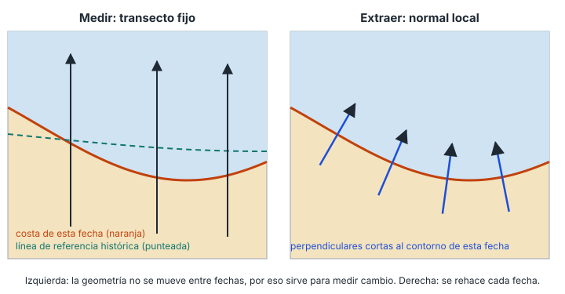
<figcaption aria-hidden="true">Izquierda: transectos fijos, perpendiculares a la línea de referencia histórica. Cruzan la costa de esta fecha en diagonal donde la costa cambió de forma. Derecha: perpendiculares cortas al contorno de esta fecha, rehechas en cada imagen.</figcaption>
</figure>

> [!TIP]
>
> **Analogía**
>
> Es como un sastre que toma medidas. Para seguir si un cliente engorda, mide siempre en el mismo lugar del cuerpo, con la huincha en la misma posición: esa es la geometría de medición. Para cortar la tela de una manga, en cambio, pone la huincha a lo largo del brazo de ese día, aunque el cliente esté con el brazo doblado: esa es la geometría de extracción.
>
> **Dónde falla:** el sastre sabe dónde está el brazo. En una imagen, la dirección de la orilla de cada fecha hay que estimarla a partir de un contorno con escalones de píxel, y esa estimación tiene error.

> [!NOTE]
>
> **Ejemplo resuelto: dos tareas, dos geometrías**
>
> En la desembocadura de un río, un transecto fijo dibujado en 1990 cruza la costa de 2020 a 25°, porque la barra de arena (el banco de arena que cierra en parte la boca del río) se movió.
>
> 1.  Medir el cambio: se sigue usando el transecto de 1990. Si se cambiara en cada fecha, la tasa mezclaría el movimiento de la playa con el giro del transecto.
> 2.  Ubicar la orilla en la imagen de 2020: un ajuste de perfil sobre el transecto de 1990 recorre la orilla en diagonal. La subida de tierra a agua se estira en 1/cos 25° ≈ 1,10 veces.
> 3.  La solución que estudia el artículo: trazar perpendiculares cortas a la línea de 2020, ajustar un perfil sobre cada una para refinar la orilla, y después medir la distancia sobre el transecto fijo de 1990.

> [!WARNING]
>
> **Error común**
>
> **Se cree que** si los transectos fijos traen un error, la solución es rehacer los transectos en cada fecha. **En realidad** eso rompe la medición: una tasa necesita una geometría que no cambie. El artículo propone separar las dos geometrías: fija para medir y rehecha en cada imagen para extraer.

> [!NOTE]
>
> **En el manuscrito (Sec. 5.4 y Tabla 3, p. 22-25)**
>
> **Extraer y medir son decisiones separadas, y solo medir debe ser fijo.** Se compararon tres formas de ubicar la orilla en 90 imágenes SR (Landsat 8 y 9, 2018-2021, 15 por sitio), contra las distancias de los transectos anclados al mar. Las tres se midieron sobre los mismos transectos fijos. «Sin refinar» es el contorno de *marching squares*; «normales locales» son perpendiculares cortas al contorno de cada imagen (Tabla 3, p. 25):
>
> | Sitios    | Refinamiento                  | Mediana     | Mediciones |
> |-----------|-------------------------------|-------------|------------|
> | Complejos | Sin refinar                   | 16,00 m     | 4797       |
> | Complejos | Perfil sobre transectos fijos | 13,90 m     | 8048       |
> | Complejos | Contorno en normales locales  | **12,46 m** | 9901       |
> | Rectos    | Sin refinar                   | 12,28 m     | 980        |
> | Rectos    | Perfil sobre transectos fijos | 11,14 m     | 1577       |
> | Rectos    | Contorno en normales locales  | **10,21 m** | 2252       |
>
> Los sitios complejos son Coquimbo, Constitución, Valdivia y Chiloé; los rectos, Viña del Mar y Arica. Refinar sobre normales locales da el menor error en los dos grupos: en los complejos, cerca de un quinto menos que sin refinar. El perfil sobre los transectos fijos queda en medio: mejora al contorno sin refinar en tres de los cuatro sitios complejos y en los dos rectos, y lo empeora solo en Constitución, el único sitio donde los transectos fijos están muy desalineados (22°, como mide la sección siguiente). Los autores lo leen como evidencia de que solo la geometría de medición debe ser fija, y advierten que la evidencia es indirecta: ven el desalineamiento por su efecto en la ventana de muestreo, sin medir el ángulo (Sec. 5.4, p. 24).

El error de esta tabla se mide contra distancias que salen de CoastSat sobre imágenes TOA. Es una comparación entre productos (SR contra TOA), como la de 9,35 m del comienzo de este nivel. Por eso los valores son de unos 10 a 16 m y no de décimas de metro.

Cada método deja un número distinto de cruces válidos, así que las medianas se comparan con cantidades de mediciones distintas. Refinar sobre normales locales es el que deja más.

En Constitución la diferencia es chica: 12,25 m con el perfil sobre transectos fijos frente a 11,75 m sin refinar. Con 22°, la subida de tierra a agua se estira solo un 8 %. Que ese desalineamiento explique el peor resultado es la lectura de los autores, no algo que la tabla demuestre.

El artículo repite la comparación con las mismas imágenes pero contra los transectos originales, los de la referencia desviada. Ahí el perfil sobre transectos fijos sale peor que no refinar en tres de los cuatro sitios complejos (14,7 contra 13,8 m). La conclusión cambiaría según qué transectos se usen (Sec. 5.4, p. 24).

## El ángulo entre transecto y costa

> [!NOTE]
>
> **Concepto: Ángulo persistente**
>
> El ángulo persistente de un transecto es la mediana, a lo largo de todas las fechas, del ángulo entre ese transecto y la normal a la costa de cada fecha. Es la parte del ángulo que se repite fecha a fecha, y por eso la única que puede sesgar una tasa.

El ángulo de un transecto cambia de una fecha a otra: la costa cambia de forma, y el estimador tiene ruido. El artículo lo separa en dos partes:

- **Persistente**: la mediana de las fechas. Si un transecto siempre cruza la costa a unos 20°, toda su serie se estira por el mismo factor 1/cos 20°, y la tasa también.
- **Fluctuante**: cuánto se aleja cada fecha de esa mediana. Un ángulo que salta al azar entre fechas estira cada fecha un poco distinto, sin relación con el año. Como el estiramiento no crece ni baja con el tiempo, mueve los puntos hacia arriba y hacia abajo sin preferir los años tempranos ni los tardíos. Según el artículo, eso desordena los puntos pero no inclina la recta (Sec. 5.5, p. 26).

> [!NOTE]
>
> **En el manuscrito (Sec. 5.5, p. 24-28; Tabla 4, p. 27; Fig. 3, p. 31)**
>
> **Sobre transectos anclados al mar, el ángulo es chico; sobre transectos desviados, aparece uno falso de 40°.** La medición usa los transectos anclados al mar y las líneas de CoastSat extraídas con ellos (Sec. 5.5, p. 24). Tres pasos la sostienen:
>
> 1.  **Contra la nula.** El mismo estimador, aplicado a la línea de referencia de la que salieron los transectos (ángulo verdadero cero), da medianas de 1,3° a 4,1° según el sitio. Para que la [nula](#c-nula) sea comparable, esa línea se preparó con los mismos escalones de píxel que los contornos reales. El ángulo medido tiene mediana 5,9° (entre 5,9° y 8,0° según el ancho de la ventana del estimador, de ±60 a ±200 m): distinto de la nula (la prueba de Mann-Whitney da un $p$ casi cero), pero solo unos grados por encima (p. 26).
> 2.  **Persistente.** El [ángulo persistente](#c-angulo-persistente) tiene mediana 5,7° sobre 857 transectos de cinco sitios, lo que equivale a una inflación de tasa de 0,5 %. Solo el 17 % supera 20°. Arica no entra, porque no se guardaron sus líneas de costa fecha por fecha. La excepción es Constitución, donde los transectos cruzan la desembocadura del Maule: 22° y una inflación implicada de 8 % (Tabla 4, p. 27). Proyectar la tasa de cada transecto sobre su normal local, es decir, multiplicarla por el coseno de su ángulo, cambiaría la mediana de las tasas entre 0 % y 10 % según el sitio (p. 26).
> 3.  **Una referencia desviada finge un ángulo grande.** Sobre los transectos originales, la misma medición da 39,9° en 538 transectos, una inflación aparente de 30 %. Solo 130 de esos 538 (24 %) tenían su origen a menos de 200 m de la costa del mar. El ángulo de esos transectos pasaba dos pruebas de coherencia: se parecía entre transectos vecinos (la [prueba de permutación](#c-permutacion) del nivel 3) y se parecía al calcularlo con dos mitades separadas de las fechas, es decir, no cambiaba en el tiempo (p. 26-27).

<figure>
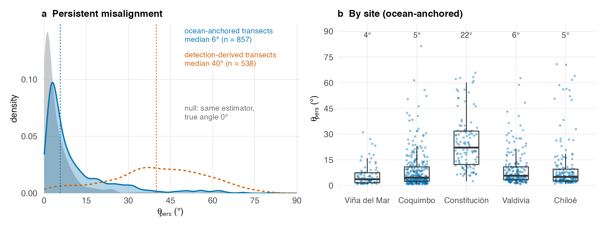
<figcaption aria-hidden="true">El ángulo persistente, del original del manuscrito (Fig. 3). (a) Transectos anclados al mar (azul) frente a la nula (gris) y frente a los transectos de la referencia desviada (naranja, segmentado). (b) El ángulo por sitio sobre los transectos anclados al mar; solo Constitución se aparta.</figcaption>
</figure>

Las dos pruebas de coherencia, entre vecinos y entre mitades de las fechas, también se calcularon sobre los transectos anclados al mar. La [correlación](#c-correlacion) entre vecinos va de 0,36 a 0,74, fuera del rango del azar que da la [permutación](#c-permutacion), y la de dos mitades separadas de las fechas va de 0,77 a 0,98 (Sec. 5.5, p. 26). Lo que queda, entonces, es un ángulo real pero chico.

Lo más instructivo es por qué la [referencia desviada](#c-referencia-desviada) pasó esas pruebas. Un transecto que sigue la orilla de un río mide un ángulo real y persistente, pero con la orilla equivocada. Su vecino sigue la misma orilla, así que su ángulo se parece. Y la orilla del río no cambia de fecha en fecha. Las pruebas separan geometría de ruido, pero no separan la costa del mar de otra geometría (p. 26-27).

> [!WARNING]
>
> **Error común**
>
> **Se cree que** si una medición es coherente entre vecinos y estable en el tiempo, entonces describe la costa que se quiere estudiar. **En realidad** solo dice que no es ruido. Una geometría equivocada pero consistente, como la orilla de un estuario, pasa las dos pruebas. Para saber si mide la costa del mar hace falta un control externo, como la distancia a la línea de costa de un mapa (Sec. 5.5, p. 28; Sec. 6, p. 34).

> [!NOTE]
>
> **Concepto: Supuesto local**
>
> El supuesto local es la condición que hace falta para que un ángulo medido infle las tasas: que la costa se desplace perpendicular a su orientación local, de unos 100 a 400 m, y no a la orientación regional que sigue la línea base. El artículo no lo demuestra.

Con un ángulo de 5,7° el supuesto casi no importa: aun si fuera cierto, la inflación sería menor a 1 %. Importa en Constitución. Ahí hay dos lecturas posibles:

- **Lectura local.** La costa retrocede perpendicular a su forma de cada tramo de unos cientos de metros. Entonces el transecto mide de más, y la tasa está inflada por 1/cos θ.
- **Lectura regional.** La costa retrocede paralela a sí misma a escala de kilómetros. Entonces el transecto perpendicular a la línea base mide en la dirección correcta.

En una desembocadura que se mueve, ninguna de las dos es segura. Por eso el artículo presenta el 8 % de Constitución como un máximo y no como un sesgo medido (Sec. 5.5, p. 28).

## La precisión de cada satélite

> [!NOTE]
>
> **En el manuscrito (Sec. 5.6 y Tabla 5, p. 32-33)**
>
> **Las diferencias de precisión entre sensores son chicas y dependen del sitio.** El motor calibra los [pesos por sensor](#c-pesos-sensor) con los datos. Quita la tendencia de cada transecto, junta los residuos por satélite y usa como peso el inverso de su varianza. Sobre las series ancladas al mar, en cinco sitios; Arica queda fuera porque sus imágenes no tienen la etiqueta del satélite (Tabla 5, p. 33):
>
> | Sitio        | Landsat 5 | Landsat 7 | Landsat 8 | Landsat 9 |
> |--------------|-----------|-----------|-----------|-----------|
> | Viña del Mar | **40,5**  | 51,6      | 42,1      | 43,2      |
> | Coquimbo     | 39,4      | 37,7      | **34,3**  | 36,8      |
> | Constitución | 48,3      | 40,8      | **39,1**  | 46,4      |
> | Valdivia     | **28,1**  | 42,6      | 31,3      | 33,5      |
> | Chiloé       | 39,3      | 39,7      | **36,8**  | 37,2      |
>
> Los valores son desviaciones típicas de los residuos, en metros; en negrita, el satélite más preciso de cada sitio. Landsat 8 es el más preciso en tres sitios y Landsat 5 en dos, Viña del Mar y Valdivia. La tabla fija del estudio de referencia supone que Landsat 5 tiene 1,5 veces más error típico que Landsat 8, es decir, 2,25 veces más varianza. La razón de varianzas medida, es decir, (desviación de Landsat 5 / desviación de Landsat 8)², va de 0,80 a 1,53: siempre menor que 2,25, y menor que 1 en dos sitios, donde Landsat 5 resulta más preciso. El artículo concluye que los pesos deben calibrarse y validarse por sitio. Y no presenta los pesos calibrados como «más exactos», porque la tasa de referencia sale de la misma tabla fija (Sec. 5.6, p. 32).

Con las series originales, de la referencia desviada, el mismo cálculo daba desviaciones de 44 a 178 m, y en Coquimbo Landsat 5 parecía 3,3 veces más ruidoso que Landsat 8. El artículo concluye que gran parte de lo que parecía ruido del sensor era la contaminación por agua interior (Sec. 5.6, p. 33).

Aun sobre las series limpias, desviaciones de 28 a 52 m son mayores que el error de unos metros que se espera de un sensor. El residuo de cada transecto incluye mucho más que la precisión del sensor: cruces múltiples, marea y tormentas, entre otros. El artículo no hace esta observación con esas palabras; sí dice que los pesos calibrados son una herramienta a validar (Sec. 5.6, p. 32).

## Lo que el artículo no demuestra

El artículo declara sus límites con cuidado. Conviene juntarlos, porque una lectura rápida de las cifras puede hacerlos olvidar.

1.  **Ninguna cifra de exactitud es contra la orilla real.** Todas las comparaciones son contra CoastSat, pyTMD o el estudio de referencia, que a su vez sale de CoastSat. Las cifras de 0,2 m y 9,35 m dicen cuánto se parecen dos programas o dos productos. No dicen a cuántos metros está la orilla verdadera.
2.  **Los análisis de geometría dependen de la referencia.** Los transectos anclados al mar salen de una línea de costa de un mapa; si ese mapa está mal, los transectos y el ángulo heredan el error. Con los transectos desviados, el ángulo salió siete veces mayor y cambió el orden de los métodos de refinado (Sec. 7, p. 36).
3.  **El sesgo de Constitución depende de un supuesto.** Que su ángulo de 22° infle la tasa requiere el supuesto local, que en una desembocadura que se mueve no está establecido (Sec. 7, p. 36).
4.  **La ventaja de extraer sobre normales locales se midió contra la referencia**, no contra datos de terreno. Los autores no encontraron trabajos previos que compararan geometría fija y por imagen. Por eso lo presentan como una observación cuantificada que otros deben confirmar (Sec. 6, p. 34). Piden además una evaluación con datos de terreno, como los sitios de la evaluación comunitaria (Vos et al. 2023), y una búsqueda dirigida en el trabajo del grupo de SHOREX (Sánchez-García et al. 2020) (Sec. 7, p. 37).
5.  **No hay clasificador para SR.** Con imágenes de superficie, el motor trabaja sin clasificador (afirmación a6).
6.  **Las cuatro divergencias** con CoastSat explican parte de las diferencias que quedan. La de mayor efecto es dónde se calcula el umbral. La única diferencia puramente numérica, el corte de 0,71 píxeles, se cerraría leyendo la distancia de forma interpolada (Sec. 4.2, p. 17; Sec. 7, p. 37).
7.  **La pendiente de la playa** necesaria para la corrección mareal se puede estimar con la serie de líneas: se busca la pendiente que hace desaparecer de la serie la huella de la marea (el método no se detalla en este material). En Viña del Mar, un sitio con mareas pequeñas, eso solo funcionó con la serie densa de Sentinel-2, y no con Landsat sola. En sitios con mareas grandes, Landsat basta (Sec. 5.3, p. 22; Sec. 7, p. 37).
8.  **Lo que el motor no hace.** No corrige la atmósfera, no hace *pansharpening*, no corrige el efecto del oleaje (el agua que las olas empujan playa arriba) y no tiene interfaz gráfica (Sec. 7, p. 38).
9.  **La facilidad de instalación no se mide.** Esta es una observación del material, no un límite que el artículo declare. La Sec. 4.4 anuncia comparar velocidad, memoria e instalación, pero en los resultados no hay cifras de memoria ni de instalación (Sec. 4.4, p. 18).
10. **Ningún esquema de pesos debe aplicarse sin validarlo.** Ni la tabla fija ni los pesos calibrados: aplicados a ciegas, los calibrados no son más seguros que la tabla que reemplazan (Sec. 6, p. 35; Sec. 7, p. 37).

Lo que el artículo defiende sin reservas es más angosto que cualquiera de estos hallazgos: el ángulo entre un transecto fijo y la costa que mide es una cantidad que se puede medir, chica en una geometría limpia y grande donde la geometría está mal, y que los estudios de cambio de costa no informan hoy (Sec. 7, p. 37).

**Pregunta 18 · recuperación**

¿Por qué el artículo no presenta los pesos calibrados por sensor como más exactos que la tabla fija?

*[Respuesta 18](#r-preg-18)*

**Pregunta 19 · recuperación**

¿Por qué los transectos de la referencia desviada pasaron las pruebas de coherencia espacial y temporal?

*[Respuesta 19](#r-preg-19)*

**Pregunta 20 · repaso**

Usando el nivel 2: sobre los transectos anclados al mar, el ángulo persistente es 5,7°, y sobre los desviados, 39,9°. Con cos 5,7° ≈ 0,995 y cos 39,9° ≈ 0,77, ¿qué inflación de tasa implica cada uno?

*[Respuesta 20](#r-preg-20)*

**Pregunta 21 · aplicación**

Un colega mide el ángulo de sus transectos y encuentra 35°, coherente entre vecinos y estable en el tiempo. Concluye que sus tasas están infladas 22 %. ¿Qué le preguntas antes de aceptarlo?

*[Respuesta 21](#r-preg-21)*

**Pregunta 22 · explícalo con tus palabras**

Ajustar un perfil sobre los transectos fijos mejora el error en la mayoría de los sitios y lo empeora en Constitución. Explica con tus palabras qué explicación dan los autores y por qué el material dice que la tabla no la demuestra.

*[Respuesta 22](#r-preg-22)*

> [!TIP]
>
> **En pocas palabras**
>
> El artículo muestra que un motor compilado puede copiar a CoastSat con fidelidad y correr su paso más lento cientos de veces más rápido. Sobre transectos anclados al mar, los transectos fijos casi no se desalinean, salvo en una desembocadura. Y una referencia desviada puede fingir un desalineamiento grande que pasa las pruebas de coherencia.

Fitzpatrick, Sharon, Daniel Buscombe, Jonathan A. Warrick, Mark A. Lundine, y Kilian Vos. 2024. “CoastSeg: an accessible and extendable hub for satellite-derived shoreline (SDS) detection and mapping”. *Journal of Open Source Software* 9 (99): 6683. <https://doi.org/10.21105/joss.06683>.

Sánchez-García, Elena, Jesús M. Palomar-Vázquez, Josep E. Pardo-Pascual, Jaime Almonacid-Caballer, Carlos Cabezas-Rabadán, y Lluís Gómez-Pujol. 2020. “An efficient protocol for accurate and massive shoreline definition from mid-resolution satellite imagery”. *Coastal Engineering* 160: 103732. <https://doi.org/10.1016/j.coastaleng.2020.103732>.

Vos, Kilian et al. 2023. “Benchmarking satellite-derived shoreline mapping algorithms”. *Communications Earth & Environment* 4: 345. <https://doi.org/10.1038/s43247-023-01001-2>.

Vos, Kilian, Kristen D. Splinter, Mitchell D. Harley, Joshua A. Simmons, y Ian L. Turner. 2019. “CoastSat: A Google Earth Engine-enabled Python toolkit to extract shorelines from publicly available satellite imagery”. *Environmental Modelling & Software* 122: 104528. <https://doi.org/10.1016/j.envsoft.2019.104528>.

# Glosario

[Ajuste de perfil](#c-ajuste-perfil)  
Un ajuste de perfil lee el MNDWI a lo largo de una línea corta que cruza la orilla, y ajusta a esos valores una curva en forma de S que sube de tierra a agua. La orilla se ubica en la mitad de la subida de la curva. *(Nivel 3)*

[Banda espectral](#c-banda)  
Una banda espectral es un rango de colores de luz que el sensor del satélite mide por separado. El sensor entrega una imagen por banda, píxel por píxel. *(Nivel 1)*

[Cadena de CoastSat](#c-coastsat)  
CoastSat es un conjunto de programas en Python que extrae líneas de costa de imágenes de satélite y es el estándar de hecho en el campo (Vos et al. 2019). Su cadena es: máscara de nubes, clasificación de píxeles, umbral de Otsu sobre el MNDWI restringido a arena y agua, contorno subpíxel y filtros sobre el contorno. *(Nivel 3)*

[Cantidad rectificada](#c-rectificada)  
Una cantidad rectificada es una medida a la que se le quitó el signo, como un valor absoluto o un ángulo entre 0° y 90°. Sus errores no se cancelan: el ruido la hace crecer en promedio, aunque el valor verdadero sea cero. *(Nivel 3)*

[Clasificador de píxeles](#c-clasificador)  
Un clasificador de píxeles es un programa que asigna a cada píxel una clase, por ejemplo arena, agua, espuma u otro, a partir de sus bandas. Aprende la regla con ejemplos ya etiquetados por personas. *(Nivel 2)*

[Constituyentes de marea](#c-constituyentes)  
Un constituyente de marea es una onda regular, con un periodo fijo (el tiempo que tarda en repetirse), causada por un movimiento concreto de la Luna o del Sol. La marea de un lugar se predice sumando muchos constituyentes, cada uno con la altura y el horario propios de ese lugar. *(Nivel 2)*

[Contorno subpíxel](#c-contorno-subpixel)  
Un contorno subpíxel es una línea que pasa por los puntos donde el índice vale exactamente el umbral, estimados entre los centros de los píxeles. Así la línea puede pasar por dentro de un píxel y no solo por sus bordes. *(Nivel 2)*

[Control de calidad](#c-control-calidad)  
El control de calidad de transectos es un conjunto de reglas que marca como poco confiable un transecto cuyas tasas no se pueden creer. El artículo usa cinco criterios en un orden fijo, y anota el primero que falla como la razón. *(Nivel 3)*

[Copia fiel](#c-copia-fiel)  
Una copia fiel de un procedimiento es una que, con los mismos ingredientes, da el mismo resultado que el original. Para saber si es fiel, se preparan las dos versiones y se comparan los resultados. *(Nivel 0)*

[Corrección mareal](#c-correccion-mareal)  
La corrección mareal traslada la orilla de cada imagen a la posición que tendría con un nivel del agua de referencia. Así las fechas se comparan como si todas tuvieran la misma marea. *(Nivel 2)*

[Correlación](#c-correlacion)  
La correlación, que se escribe $r$, mide cuánto se mueven juntas dos listas de números. Va de −1 (cuando una sube, la otra baja) a +1 (suben juntas); 0 indica que no hay relación lineal. *(Nivel 2)*

[Diferencia normalizada](#c-diferencia-normalizada)  
Una diferencia normalizada combina dos bandas de un píxel así: la resta de las dos dividida por su suma. El resultado siempre queda entre −1 y +1 si ambas reflectancias son positivas. *(Nivel 2)*

[Distancia a lo largo del transecto](#c-chainage)  
La distancia a lo largo del transecto es cuántos metros hay desde el origen del transecto, en tierra, hasta el punto donde lo cruza la línea de costa de una fecha. Con ella, una línea completa se reduce a un solo número por transecto y por fecha. *(Nivel 1)*

[Distancia oblicua](#c-coseno)  
Si un transecto cruza la orilla con un ángulo θ respecto de la perpendicular, mide la distancia perpendicular dividida por cos θ, un número que vale 1 con θ = 0° y baja hacia 0 a medida que θ crece. Por eso el transecto oblicuo nunca mide menos que el desplazamiento perpendicular. *(Nivel 2)*

[Distribución nula](#c-nula)  
Una distribución nula es lo que daría una medición si el efecto que buscas no existiera. Se obtiene aplicando el mismo procedimiento a datos donde sabes que el efecto es cero, y la señal es lo que sobresale de ella. *(Nivel 3)*

[Divergencias documentadas](#c-divergencias)  
Las divergencias documentadas son los puntos donde strandline, a propósito, no hace lo mismo que CoastSat. El artículo los declara para que las diferencias que quedan en los resultados se puedan atribuir a una causa y no se confundan con errores de copia. *(Nivel 4)*

[El agua se traga la luz](#c-agua-oscura)  
El agua profunda absorbe casi toda la luz que le llega y se ve oscura. La arena seca devuelve mucha luz y se ve clara. *(Nivel 0)*

[Geometría de extracción y de medición](#c-geom-extraccion-medicion)  
La geometría de medición es la de los transectos sobre los que se mide el cambio, y tiene que quedar fija en el tiempo. La geometría de extracción es la de las líneas sobre las que se ubica la orilla en cada imagen, y no necesita ser fija. El artículo sostiene que conviene separarlas: fija para medir, rehecha en cada imagen para extraer. *(Nivel 4)*

[Imagen hecha de cuadraditos](#c-foto-cuadraditos)  
Una foto digital está hecha de cuadraditos. Cada cuadradito tiene un solo color, aunque en la realidad ese pedazo de suelo tenga varias cosas. *(Nivel 0)*

[Intersección con franja](#c-interseccion)  
La intersección con franja calcula la distancia a lo largo de un transecto usando los vértices de la línea de costa que caen en una franja angosta alrededor de él. Cada vértice se proyecta sobre el transecto, y un control descarta el cruce si los valores son demasiado dispersos o escasos. *(Nivel 3)*

[Línea de costa que se mueve](#c-costa-movil)  
La línea de costa es el borde entre el agua y la tierra. No se queda quieta: cambia de lugar en horas, en meses y en décadas. *(Nivel 0)*

[Marea](#c-marea)  
La marea es la subida y bajada del nivel del mar, por lo general dos veces al día. El rango mareal es la diferencia entre la marea alta y la baja. *(Nivel 1)*

[Mediana, media y percentil 90](#c-resumen-estadistico)  
La mediana de una lista de números es el valor del medio cuando se ordenan: la mitad queda abajo y la mitad arriba. La media es la suma dividida por la cantidad, y el percentil 90 es el valor que deja al 90 % de los números en él o por debajo. *(Nivel 1)*

[Misiones y sensores](#c-misiones)  
Una misión es una serie de satélites, y cada satélite lleva un sensor, que es el instrumento que mide las bandas. El artículo usa Landsat 5, 7, 8 y 9 y, en algunos sitios, Sentinel-2. *(Nivel 1)*

[MNDWI](#c-mndwi)  
El MNDWI (por su nombre en inglés, índice de agua de diferencia normalizada modificado) es la diferencia normalizada entre la banda verde y la banda SWIR1. Es alto sobre el agua y bajo sobre la tierra. *(Nivel 2)*

[Máscara de nubes](#c-mascara-nubes)  
Una máscara de nubes es una segunda imagen, del mismo tamaño, que marca qué píxeles están cubiertos por nubes. Esos píxeles no se usan para buscar la orilla. *(Nivel 1)*

[Otsu balanceado](#c-otsu-balanceado)  
El Otsu balanceado calcula el umbral entre dos clases, arena y agua, dando a ambas el mismo peso, aunque una tenga muchos más píxeles que la otra. Sin balance, la clase más numerosa arrastra el umbral hacia su lado. *(Nivel 3)*

[Paralelismo determinista](#c-paralelo-determinista)  
Paralelizar es repartir un cálculo entre varios núcleos del procesador para que terminen antes. El paralelismo es determinista cuando el resultado es idéntico, bit a bit, al del cálculo en un solo núcleo. *(Nivel 3)*

[Pesos por sensor](#c-pesos-sensor)  
Los pesos por sensor son números que dicen cuánto confiar en cada observación de la WLR según el satélite que la tomó. Un sensor más preciso recibe más peso, para que sus fechas pesen más en la pendiente. *(Nivel 3)*

[Programa compilado e interpretado](#c-compilado)  
Un programa interpretado se traduce a instrucciones de máquina línea por línea mientras corre. Un programa compilado se traduce entero una vez, antes de correr, y queda como un solo archivo ejecutable, llamado binario. *(Nivel 1)*

[Prueba de equivalencia](#c-equivalencia)  
Una prueba de equivalencia compara la salida de un programa con la de una implementación de referencia, con las mismas entradas, para mostrar que hacen el mismo cálculo. No dice si el cálculo es correcto respecto del mundo real. *(Nivel 3)*

[Prueba de permutación](#c-permutacion)  
Una prueba de permutación mide qué tan grande puede salir un estadístico por casualidad, desordenando los datos al azar muchas veces y recalculándolo. Si el valor real queda fuera del rango de los desordenados, no se explica por azar. *(Nivel 3)*

[Píxel y resolución](#c-pixel)  
Un píxel es cada cuadradito de una imagen digital: el satélite le asigna un solo valor. La resolución es el tamaño en el terreno del lado de un píxel; una resolución de 30 m significa cuadraditos de 30 por 30 metros. *(Nivel 1)*

[Razón intercalada](#c-razon-intercalada)  
La razón intercalada (aquí «razón» es un cociente de tiempos; en el control de calidad, «razón» era el motivo de exclusión) es la forma en que el artículo mide cuántas veces más rápido es su motor: alterna una corrida de cada programa en cada repetición y calcula la razón de tiempos dentro de cada repetición. Así una carga pasajera del computador afecta a los dos lados por igual. *(Nivel 4)*

[Receta con ingredientes ajenos](#c-receta-ingredientes)  
Una receta que pide ingredientes de muchas tiendas distintas es frágil. Si una tienda cierra o cambia un producto, la receta deja de funcionar aunque no haya cambiado nada en ella. *(Nivel 0)*

[Referencia desviada](#c-referencia-desviada)  
Una referencia desviada es una línea de referencia que, por error, se fue tierra adentro y sigue la orilla de un estuario, una laguna o un río en vez de la costa del mar. Los transectos generados desde ella miden esas orillas interiores, y sus series pasan los controles habituales como si fueran de la playa. *(Nivel 4)*

[Reflectancia](#c-reflectancia)  
La reflectancia es la fracción de la luz que llega a un píxel y que ese píxel devuelve, en una banda. Va de 0 (devuelve nada) a 1 (devuelve todo). *(Nivel 1)*

[Reflectancia TOA y de superficie](#c-toa-sr)  
La reflectancia en el techo de la atmósfera (TOA) es la que mide el satélite, con el efecto del aire incluido. La reflectancia de superficie (SR) es la que queda después de restar con un modelo el efecto de la atmósfera. *(Nivel 2)*

[Regla clavada en la playa](#c-regla-playa)  
Para medir cuánto se mueve la orilla, conviene clavar una regla en la arena, apuntando al mar. En cada visita se anota dónde llega el agua sobre esa regla. *(Nivel 0)*

[Regresión lineal y R²](#c-regresion)  
Una regresión lineal busca la recta que pasa más cerca de un conjunto de puntos. Su pendiente es la tendencia, y el R² dice qué fracción de la variación de los puntos explica la recta, de 0 (nada) a 1 (todo). *(Nivel 2)*

[strandline](#c-strandline)  
strandline es el programa que presenta el artículo: un motor compilado, escrito en Rust, que copia la cadena de CoastSat y le agrega síntesis de marea, intersección paralela de transectos y tasas con control de calidad. Se instala como un solo binario, que al correr no necesita Python ni bibliotecas numéricas externas. *(Nivel 4)*

[Supuesto local](#c-supuesto-local)  
El supuesto local es la condición que hace falta para que un ángulo medido infle las tasas: que la costa se desplace perpendicular a su orientación local, de unos 100 a 400 m, y no a la orientación regional que sigue la línea base. El artículo no lo demuestra. *(Nivel 4)*

[Tasas de cambio](#c-tasas)  
Las tasas de cambio resumen la serie de distancias de un transecto en números de metros o de metros por año. Las principales son NSM, SCE, EPR, LRR y WLR, definidas originalmente en la herramienta DSAS del Servicio Geológico de Estados Unidos. *(Nivel 3)*

[Tendencia entre mediciones ruidosas](#c-tendencia-ruido)  
Una tendencia es el cambio que se mantiene a lo largo de muchas mediciones. Las subidas y bajadas de cada medición alrededor de esa tendencia se llaman ruido. *(Nivel 0)*

[Transecto y línea base](#c-transecto)  
Un transecto es una línea recta fija que va desde tierra hacia el mar, cruzando la orilla. La línea base es una línea dibujada en tierra, paralela a la costa, desde la que salen los transectos, uno cada cierta distancia. *(Nivel 1)*

[Umbral de Otsu](#c-otsu)  
El umbral de Otsu es un método automático para elegir el valor que separa dos grupos en una lista de números. Elige el corte que deja cada grupo lo más parejo posible por dentro y los dos grupos lo más separados entre sí. *(Nivel 2)*

[Ángulo persistente](#c-angulo-persistente)  
El ángulo persistente de un transecto es la mediana, a lo largo de todas las fechas, del ángulo entre ese transecto y la normal a la costa de cada fecha. Es la parte del ángulo que se repite fecha a fecha, y por eso la única que puede sesgar una tasa. *(Nivel 4)*

# Respuestas

**Respuesta D1** [↩](#diag-1)

Miras la tendencia de todas las medidas juntas, no la diferencia entre dos años sueltos. Una medida aislada puede estar alta o baja por la marea o por una tormenta.

**Respuesta D2** [↩](#diag-2)

Es una línea fija que va de tierra hacia el mar. A lo largo de ella se mide la distancia desde su origen en tierra hasta donde la cruza la línea de costa de cada fecha.

**Respuesta D3** [↩](#diag-3)

10 / cos 60° = 10 / 0,5 = 20 m. El transecto oblicuo mide el doble del retroceso real.

**Respuesta D4** [↩](#diag-4)

Porque el valor absoluto convierte todo error en positivo. Los errores hacia un lado y hacia el otro no se cancelan: se suman. Por eso hace falta una distribución nula para saber cuánto da el estimador cuando la verdad es cero.

**Respuesta E1** [↩](#ejer-1)

Con la primera y la última, el retroceso total es 62 − 50 = 12 m. La medida de 2017 (55) está más baja que las de 2015 (62) y 2019 (60): es una caída suelta, probablemente ruido. Mirar todas las medidas evita que una medida rara decida el resultado.

**Respuesta 1** [↩](#preg-1)

Porque si cambia de lugar entre visitas, no se puede saber si lo que cambió fue la playa o la huincha.

**Respuesta 2** [↩](#preg-2)

Prueba que la copia es fiel: que hace lo mismo que el original. No prueba que el resultado sea bueno.

**Respuesta 3** [↩](#preg-3)

Porque en un solo día la orilla se mueve mucho más que 1 m por la marea y las olas. La diferencia entre dos fotos puede deberse a la marea de cada día y no al retroceso. Para ver el retroceso hay que juntar muchas fechas y buscar la tendencia.

**Respuesta E2** [↩](#ejer-2)

La mediana es 0,3 m (el cuarto de siete valores). La media es 10,7 / 7 ≈ 1,53 m. La mediana describe mejor el caso típico: el error de 9 m sube la media aunque seis de siete errores sean menores de medio metro.

**Respuesta 4** [↩](#preg-4)

La distancia a lo largo del transecto: los metros desde el origen en tierra hasta el punto donde la orilla cruza el transecto.

**Respuesta 5** [↩](#preg-5)

El infrarrojo de onda corta, SWIR1 (y también el NIR).

**Respuesta 6** [↩](#preg-6)

La mediana: con seis valores, los del medio son 0,2 y 0,3, y la mediana es 0,25 m. Dice que el caso típico tiene un error de un cuarto de metro. La media de 8,5 m la produce un solo caso de 50 m.

**Respuesta 7** [↩](#preg-7)

Porque la marea se atrasa cada día, y el satélite, que pasa a la misma hora del reloj, encuentra cada vez una marea distinta. Con marea alta, el agua sube por la playa y la orilla queda más tierra adentro. También influyen las olas del día y el sensor que tomó la imagen.

**Respuesta E3** [↩](#ejer-3)

Resta = 0,02. Suma = 0,22. MNDWI ≈ +0,09. Queda entre los dos: está lejos de +0,78 (mar) y de −0,33 (arena). Un píxel mezclado tiene un valor intermedio, y eso es lo que permite ubicar la orilla dentro de él.

**Respuesta E4** [↩](#ejer-4)

$t = (0{,}1 - 0{,}5) / (-0{,}3 - 0{,}5) = -0{,}4 / -0{,}8 = 0{,}5$. El cruce queda a 15 m del primer centro. Si los valores hubieran sido +0,5 y −0,7, $t$ sería 0,33 y el cruce quedaría a 10 m.

**Respuesta E5** [↩](#ejer-5)

$\Delta x = 0{,}5 / 0{,}025 = 20$ m. Es cuatro veces mayor que los 5 m de la playa con $\tan\beta = 0{,}1$, porque la pendiente es cuatro veces menor. En una playa plana, la marea mueve mucho la orilla.

**Respuesta E6** [↩](#ejer-6)

6 / 0,866 ≈ 6,93 m. La inflación es de 15,5 %. Funciona igual para un avance que para un retroceso: se agranda el valor absoluto del cambio, sin cambiar su signo.

**Respuesta 8** [↩](#preg-8)

Porque el agua devuelve algo de luz verde y casi nada de SWIR1. La resta verde − SWIR1 es positiva y, dividida por una suma parecida a esa resta, se acerca a +1.

**Respuesta 9** [↩](#preg-9)

Las constantes armónicas del lugar (amplitud y desfase de cada constituyente), la posición de la Luna y el Sol en esa fecha, y las correcciones lentas, como la nodal.

**Respuesta 10** [↩](#preg-10)

Δx = −0,2 / 0,05 = −4 m. Con el agua más baja, la orilla de la imagen está 4 m más hacia el mar que con la marea de referencia. Con la distancia creciendo hacia el mar, $x_\mathrm{corr} = x_\mathrm{bruta} + (-4)$: la corrección la mueve 4 m hacia tierra.

**Respuesta 11** [↩](#preg-11)

No. Cada transecto mide el retroceso dividido por cos 35° ≈ 0,82: los dos inflan la tasa en 22 %. El coseno no distingue el signo del ángulo, así que no hay cancelación. Es la misma idea del nivel 0: la huincha en diagonal siempre mide de más.

**Respuesta 12** [↩](#preg-12)

Porque la línea se define como el lugar donde el MNDWI vale exactamente el umbral. Si subes el umbral, el punto donde el índice lo alcanza se corre hacia el agua, porque hay que entrar más al mar para llegar a ese valor. La playa no cambió. Cambió la regla que dice dónde está la orilla.

**Respuesta E7** [↩](#ejer-7)

NSM = 0 m. SCE = 20 m. EPR = 0 m/año. Con estos datos la playa se quedó igual entre los extremos. El SCE de 20 m muestra que algo la movió en 2010: una sola medida o un evento real. Haría falta mirar más fechas.

**Respuesta 13** [↩](#preg-13)

La EPR usa solo la primera y la última fecha: divide el movimiento neto por los años transcurridos. La LRR usa todas las fechas: es la pendiente de la regresión lineal. La LRR es menos sensible a una fecha rara.

**Respuesta 14** [↩](#preg-14)

Aplicando el mismo estimador a una línea donde el ángulo verdadero es cero por construcción, por ejemplo la línea desde la que se generaron los transectos. Lo que dé el estimador ahí es lo que da el ruido solo.

**Respuesta 15** [↩](#preg-15)

No da 0° porque el ángulo es una cantidad rectificada: los errores hacia un lado y hacia el otro no se cancelan. De los 8°, unos 4° pueden ser solo ruido, y solo lo que sobresale de la nula es señal. Hace falta separarlos porque solo un ángulo real infla la tasa por 1/cos θ, como en el nivel 2; el ruido del estimador no cambia la distancia que mide el transecto.

**Respuesta 16** [↩](#preg-16)

Porque compara dos programas, no un programa con la realidad. Si CoastSat pone la línea 5 m mal y strandline la copia, coinciden a 0 m y los dos tienen 5 m de error. La prueba de equivalencia muestra fidelidad. La exactitud necesita mediciones de terreno.

**Respuesta 17** [↩](#preg-17)

Que la correlación entre vecinos no se distingue del azar. Con esos datos, el ángulo no muestra estructura espacial, y podría ser ruido del estimador.

**Respuesta 18** [↩](#preg-18)

Porque la tasa de referencia contra la que podría compararlos se calculó con esa misma tabla fija. Parecerse a ella mide el parecido a una suposición, no la exactitud. Haría falta una tasa independiente.

**Respuesta 19** [↩](#preg-19)

Porque seguían una orilla real, la de un estuario o un río, aunque no fuera la del mar. Esa orilla da ángulos parecidos entre transectos vecinos y no cambia en el tiempo. Las pruebas separan geometría de ruido, no la costa correcta de otra geometría.

**Respuesta 20** [↩](#preg-20)

Con 5,7°: 1 / 0,995 ≈ 1,005, una inflación de 0,5 %. Con 39,9°: 1 / 0,77 ≈ 1,30, una inflación de 30 %. La misma fórmula da un sesgo despreciable o uno grande según qué transectos se usen.

**Respuesta 21** [↩](#preg-21)

Si sus transectos miden la costa del mar. Las pruebas de coherencia no lo garantizan: una referencia desviada hacia un estuario o un río da un ángulo grande, coherente y estable. Le pediría comprobar con un control externo, como la distancia del origen de cada transecto a la línea de costa de un mapa. Y, si los transectos están bien, recordarle que la inflación depende además del supuesto local.

**Respuesta 22** [↩](#preg-22)

Los autores lo atribuyen al desalineamiento: donde los transectos fijos cruzan la orilla casi de frente, el perfil aprovecha todos los valores para ubicarla mejor; en Constitución, la desembocadura se movió y el transecto cruza la orilla a unos 22°, así que el perfil se lee en diagonal. La tabla no lo demuestra porque la diferencia es chica (12,25 frente a 11,75 m) y un ángulo de 22° estira la subida solo un 8 %. Es una explicación coherente, no una prueba.
